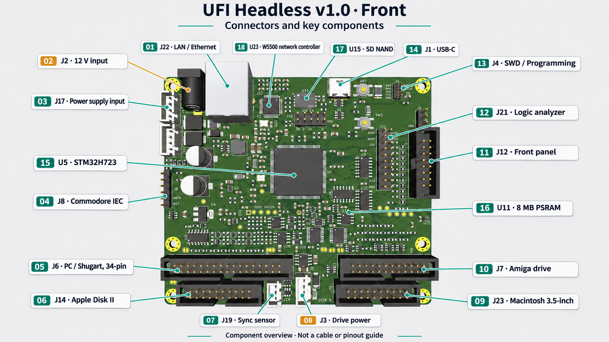
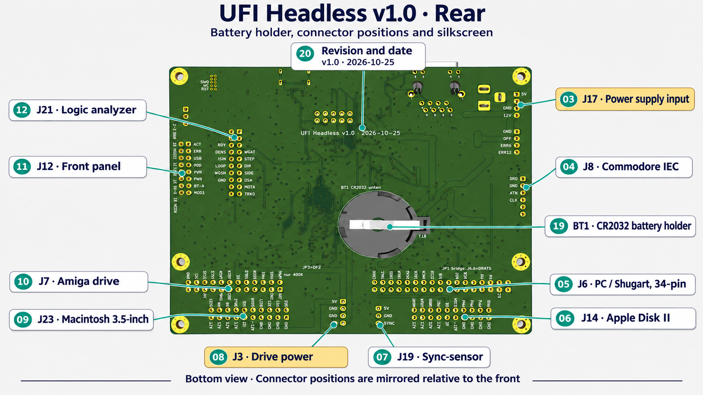

# Annotated board overview

**Sprache / Language:** [Deutsch](Platinenuebersicht) | [English](Board-Overview)

These views show UFI Headless v1.0 from the top and bottom. Matching connectors use the same number in both images. The rear view is mirrored relative to the front.

The annotations were created by editing the supplied renders. They provide orientation. For wiring, pin 1 and electrical assignments, use the schematic and unmodified original views.

## Front

[Unannotated front view](images/UFI-Headless-front-original.png)

## Rear

[Unannotated rear view](images/UFI-Headless-back-original.png)

## Key

| Number | Reference | Function |
|---|---|---|
| 01 | J22 | LAN / Ethernet |
| 02 | J2 | 12 V input |
| 03 | J17 | Power supply input |
| 04 | J8 | Commodore IEC |
| 05 | J6 | PC / Shugart, 34-pin |
| 06 | J14 | Apple Disk II |
| 07 | J19 | Sync sensor |
| 08 | J3 | Drive power |
| 09 | J23 | Macintosh 3.5-inch |
| 10 | J7 | Amiga drive |
| 11 | J12 | Front panel |
| 12 | J21 | Logic analyzer |
| 13 | J4 | SWD / programming |
| 14 | J1 | USB-C |
| 15 | U5 | STM32H723 |
| 16 | U11 | 8 MB PSRAM |
| 17 | U15 | SD NAND |
| 18 | U23 | W5500 network controller |
| 19 | BT1 | CR2032 battery holder on the underside |
| 20 | Silkscreen | Revision and date |

Assignments follow the v1.0 [KiCad layout](https://github.com/Axel051171/UniversalFluxInterface/blob/main/kicad/UFI_Headless/UFI_Headless.kicad_pcb). The images do not label every connector and solder bridge.

Next: [Connections](Connections) · [Hardware](Hardware-EN) · [Bring-up](Bring-up).
