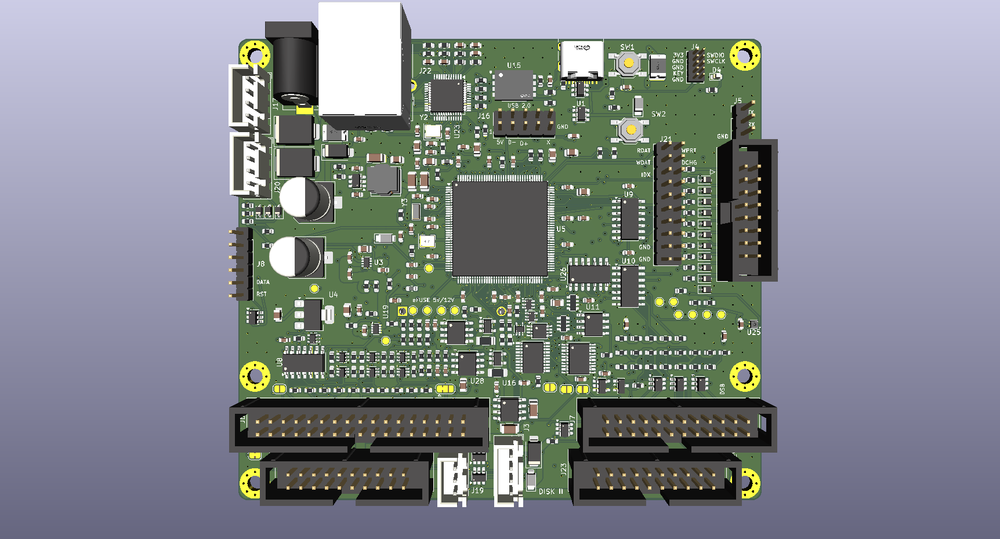
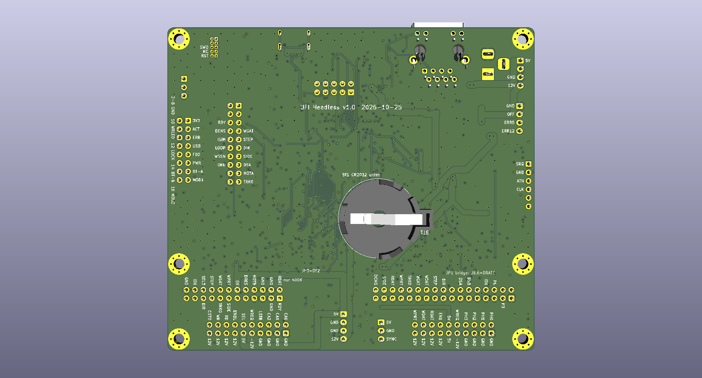

# Hardware

**Sprache / Language:** [Deutsch](Hardware) | [English](Hardware-EN)

The current Headless v1.0 board connects drives directly to an STM32H723. The processor records flux-transition timestamps; no separate computer is required on the board.

[Benefits and comparison](Benefits-and-Comparison) explains the integrated interfaces, power management and operating modes in relation to other flux systems.

## Main components

| Component | Purpose |
|---|---|
| STM32H723ZGT6 | Drive control, capture, writing, analysis and transport |
| 8 MB PSRAM | Flux buffering and the live-stream ring |
| SD NAND | Standalone images, configuration and logs |
| USB-C | Board power and host connection |
| W5500 with RJ45 | Network interface on v1.0 |
| eFuses and current sensing | Drive power monitoring |
| Hardware write lock | Combines the front switch and firmware enable |
| TCXO, RTC and SHT40 | Clock source, real-time clock, temperature and humidity |

## Timebase and memory

The flux timers nominally run at 275 MHz: approximately 3.64 ns per tick. Input circuitry, clock source and start latency affect the actual measurement and require hardware qualification.

PSRAM is tested at startup. If unavailable, firmware falls back to a smaller internal buffer. Usable capacity depends on mode and reservations; `ufi diagnostics` and `ufi write-limits` report effective limits.

USB uses the internal **Full-Speed PHY**. The peripheral name `USB_OTG_HS` does not mean this board has a High-Speed USB connection.

## Board images

The [annotated board overview](Board-Overview) identifies connectors and components with numbered callouts. Unmodified input images are available here and on that page. For wiring and revision identification, compare your board's silkscreen with its schematic.

## Manufacturing files

The released v1.0 manufacturing state is recorded by tag `hw-v1.0`. Manufacturing release does not replace functional measurements on an assembled board.

- [KiCad project](https://github.com/Axel051171/UniversalFluxInterface/tree/main/kicad/UFI_Headless)
- [v1.0 release report, German](https://github.com/Axel051171/UniversalFluxInterface/blob/main/kicad/UFI_Headless/docs/Freigabe_v1.0.md)
- [Gerber, BOM, CPL and STEP](https://github.com/Axel051171/UniversalFluxInterface/tree/main/kicad/UFI_Headless/fertigung)
- [Ordering instructions, German](https://github.com/Axel051171/UniversalFluxInterface/blob/main/kicad/UFI_Headless/docs/Bestellung_JLC.md)

Stock levels and prices in dated manufacturing reports are historical. Recheck them with the supplier before ordering.

Next: [Connections](Connections) · [Bring-up](Bring-up) · [Project status](Project-Status).
