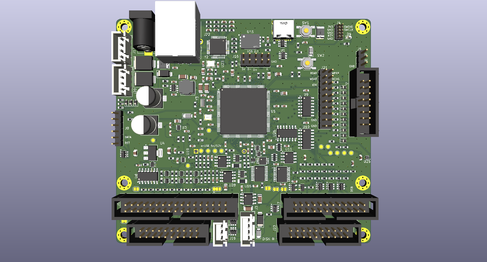
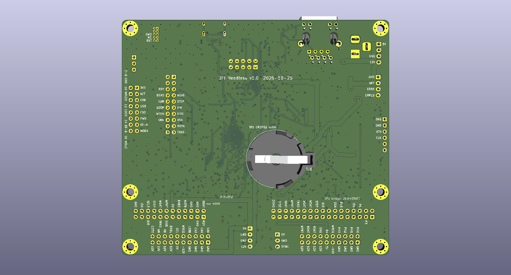

# Hardware

**Sprache / Language:** [Deutsch](Hardware) | [English](Hardware-EN)

Die aktuelle Headless-Platine v1.0 verbindet Laufwerke direkt mit einem STM32H723. Der Prozessor erfasst die Zeitpunkte der Fluxwechsel; ein separater Rechner auf der Platine ist nicht erforderlich.

Die Vorteile der integrierten Schnittstellen, Versorgung und Betriebsarten gegenüber anderen Flux-Systemen erklärt [Vorteile und Vergleich](Vorteile-und-Vergleich).

## Baugruppen

| Baugruppe | Aufgabe |
|---|---|
| STM32H723ZGT6 | Laufwerkssteuerung, Capture, Schreiben, Analyse und Transport |
| 8 MB PSRAM | Flux-Puffer und Ring für laufende Übertragungen |
| SD-NAND | Standalone-Abbilder, Konfiguration und Protokolle |
| USB-C | Versorgung des Boards und USB-Verbindung zum Host |
| W5500 mit RJ45 | Netzwerkschnittstelle auf v1.0 |
| eFuses und Strommessung | Überwachung der Laufwerksversorgung |
| Hardware-Schreibsperre | Verknüpft Frontschalter und Firmware-Freigabe |
| TCXO, RTC und SHT40 | Taktquelle, Uhr sowie Temperatur- und Feuchtemessung |

## Zeitauflösung und Speicher

Die Flux-Timer laufen nominell mit 275 MHz. Ein Tick entspricht etwa 3,64 ns. Eingangsschaltung, Taktquelle und Startlatenz beeinflussen die tatsächliche Messung und müssen am Gerät qualifiziert werden.

Der PSRAM wird beim Start geprüft. Bei Nichtverfügbarkeit verwendet die Firmware einen kleineren internen Speicher. Seine nutzbare Kapazität hängt von Betriebsart und Reservierungen ab; `ufi diagnostics` und `ufi write-limits` liefern die wirksamen Grenzen.

USB verwendet den internen **Full-Speed-PHY**. Der interne Peripheriename `USB_OTG_HS` beschreibt keine USB-High-Speed-Verbindung dieses Boards.

## Platinenansichten

Die [beschriftete Platinenübersicht](Platinenuebersicht) erklärt Anschlüsse und Baugruppen mit nummerierten Rechtecken. Die unveränderten Ausgangsbilder stehen hier sowie auf der Übersichtsseite bereit. Für Verkabelung und Revision immer den Bestückungsdruck des eigenen Boards mit dem zugehörigen Schaltplan abgleichen.

## Fertigungsunterlagen

Der Fertigungsstand v1.0 ist im Tag `hw-v1.0` dokumentiert. Eine Fertigungsfreigabe ersetzt keine Funktionsmessung am aufgebauten Gerät.

- [KiCad-Projekt](https://github.com/Axel051171/UniversalFluxInterface/tree/main/kicad/UFI_Headless)
- [Freigabebericht v1.0](https://github.com/Axel051171/UniversalFluxInterface/blob/main/kicad/UFI_Headless/docs/Freigabe_v1.0.md)
- [Gerber, BOM, CPL und STEP](https://github.com/Axel051171/UniversalFluxInterface/tree/main/kicad/UFI_Headless/fertigung)
- [Bestell-Anleitung](https://github.com/Axel051171/UniversalFluxInterface/blob/main/kicad/UFI_Headless/docs/Bestellung_JLC.md)

Lagerbestände und Preise in datierten Fertigungsberichten sind historische Angaben. Vor einer neuen Bestellung müssen sie beim Lieferanten erneut geprüft werden.

Weiter: [Anschlüsse](Anschluesse) · [Inbetriebnahme](Inbetriebnahme) · [Projektstatus](Projektstatus).
