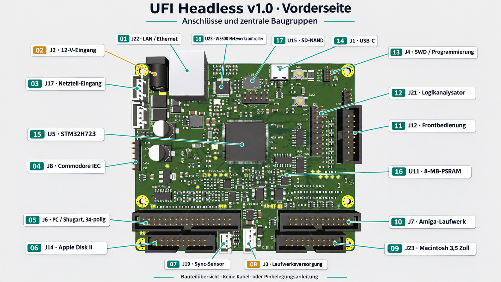
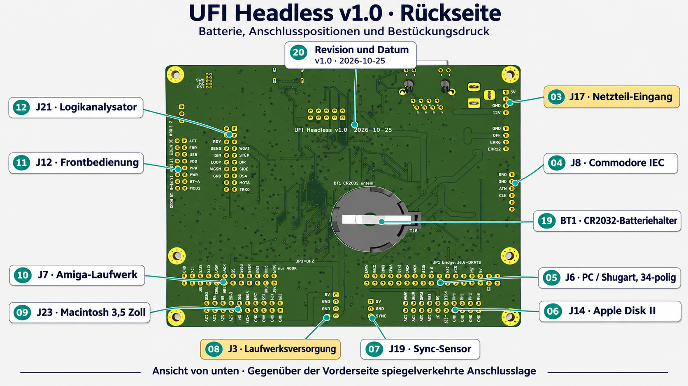

# Beschriftete Platinenübersicht

**Sprache / Language:** [Deutsch](Platinenuebersicht) | [English](Board-Overview)

Die Ansichten zeigen UFI Headless v1.0 von oben und unten. Zusammengehörige Anschlüsse tragen in beiden Abbildungen dieselbe Nummer. Die Rückseite ist gegenüber der Vorderseite spiegelverkehrt angeordnet.

Die Beschriftungen wurden mit Bildbearbeitung auf Grundlage der bereitgestellten Renderings erstellt. Sie dienen der Orientierung; für Kabel, Pin-1-Lage und elektrische Belegung den Schaltplan und die unveränderten Originalansichten verwenden.

## Vorderseite

[Vorderseite ohne Beschriftung](images/UFI-Headless-front-original.png)

## Rückseite

[Rückseite ohne Beschriftung](images/UFI-Headless-back-original.png)

## Legende

| Nummer | Referenz | Funktion |
|---|---|---|
| 01 | J22 | LAN / Ethernet |
| 02 | J2 | 12-V-Eingang |
| 03 | J17 | Netzteil-Eingang |
| 04 | J8 | Commodore IEC |
| 05 | J6 | PC / Shugart, 34-polig |
| 06 | J14 | Apple Disk II |
| 07 | J19 | Sync-Sensor |
| 08 | J3 | Laufwerksversorgung |
| 09 | J23 | Macintosh 3,5 Zoll |
| 10 | J7 | Amiga-Laufwerk |
| 11 | J12 | Frontbedienung |
| 12 | J21 | Logikanalysator |
| 13 | J4 | SWD / Programmierung |
| 14 | J1 | USB-C |
| 15 | U5 | STM32H723 |
| 16 | U11 | 8-MB-PSRAM |
| 17 | U15 | SD-NAND |
| 18 | U23 | W5500-Netzwerkcontroller |
| 19 | BT1 | CR2032-Batteriehalter auf der Unterseite |
| 20 | Bestückungsdruck | Revision und Datum |

Die Zuordnung folgt dem v1.0-[KiCad-Layout](https://github.com/Axel051171/UniversalFluxInterface/blob/main/kicad/UFI_Headless/UFI_Headless.kicad_pcb). Weitere Anschlüsse und Lötbrücken sind nicht alle in der Bildlegende enthalten.

Weiter: [Anschlüsse](Anschluesse) · [Hardware](Hardware) · [Inbetriebnahme](Inbetriebnahme).
