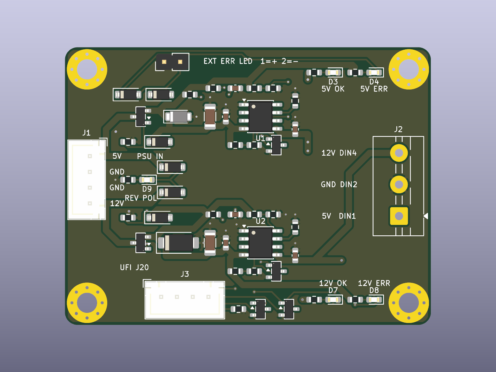

# C64 PSU Guard – geschützte 5 V / 12 V für ein 1541-II / 1581 aus einem PC-Netzteil

Status: **Schaltplan + Layout v0.2** (2026-10-26, Review vom 2026-10-24 umgesetzt), ERC 0/0, DRC 0/0/0, Lastpfade mit `check_routing.py` gemessen (2 Lagen, 58 × 44 mm, JLCPCB-Bestückung), **noch nicht gebaut**.

Änderungen v0.1 → v0.2: J1 und J3 verpolsichere JST-XH-Stecker (B4B-XH-A) statt Stiftleisten, D6 SMAJ13A (unidirektional) statt SMAJ15CA, 100k-Pull-ups R20/R21 an FLT5/FLT12, Lastpfade durchgehend 1,0 mm (v0.1: Zwischenknoten V5_P/V12_P nur 0,25 mm, weil das Netzklassen-Muster den Blattpräfix `/` nicht traf), J3 1:1 auf UFI v1.0 J20 GUARD.

Eigenständige Platine, unabhängig vom UFI-Board. Sie sitzt zwischen dem internen PC-Netzteil des Geräts und dem 4-poligen DIN-Stromanschluss des Commodore-Laufwerks (Original-Netzteil DV-5128UP: 5 V 700 mA, 12 V 500 mA) und ersetzt dessen Schutzfunktion. Ein PC-Netzteil liefert auf beiden Schienen viele Ampere, ohne Begrenzung würde ein Kurzschluss im Laufwerk das dünne DIN-Kabel und die Laufwerksplatine beschädigen.



Klemme J2 mit Ersatzmodell (Phoenix MKDS, gleiche Bauform) zur Kontrolle der Drahtöffnungen: `docs/j2_terminal_standin.png` (`scripts/render_j2_standin.py`).

## Was die Platine erkennt und tut

Zwei gleiche Kanäle (5 V und 12 V), je:

| Block | Teile | Verhalten |
|---|---|---|
| Verpolschutz | AO3401A als ideale Diode (Q1/Q3), Gate über 100k an GND, BZT52C10 klemmt Vgs | negative Eingangsspannung: Kanal bleibt stromlos, LED **REV POL** (D9) leuchtet (über 1N4148W D10/D11 von der negativen Schiene gespeist) |
| Eingangsschutz | SMF5.0CA (5 V, bidirektional) / SMAJ13A (12 V, unidirektional, Kathode an V12_P), 10 µF + 100 nF | Spannungsspitzen vom Netzteil; SMAJ13A: V_RWM 13 V, V_BR 14,4–15,9 V bei 1 mA, V_C 21,5 V bei 18,6 A (Vishay-Tabelle SMAJ13A, JLC-Daten Diodes SMAJ13A-13-F gleich, I_R ≤ 5 µA) – unter dem 22-V-Kurzzeitwert (≤ 10 ms) des TPS25921A; der SMAJ15CA aus v0.1 klemmte erst bei 24,4 V |
| eFuse | TPS25921ADR (U1/U2), SOIC-8 | Strombegrenzung, Schnellabschaltung in 3 µs, Über-/Unterspannung über Teiler, Sanftanlauf 22 nF, thermischer Schutz, **Auto-Retry** |
| Anzeige | grün am Ausgang (**5V OK** D3, **12V OK** D7), rot am FLT-Pin (**5V ERR** D4, **12V ERR** D8), FLT zusätzlich mit 100k (R20/R21) auf V5_P/V12_P | rot = FLT aktiv: Über-/Unterspannung, ENUV aus (OFF) oder thermische Abschaltung; erlischt, sobald der Fehler weg ist. **Während der reinen Strombegrenzung bleibt Rot aus** (FLT meldet sie nicht), Rot kommt erst mit der thermischen Abschaltung (Kurzschluss: blinkt im Takt Abschaltung / Retry) |
| UFI-Anschluss | J3 (JST XH) für UFI J20, 2N7002 (Q2/Q4) ziehen ENUV nach GND | Pin 2 OFF high = beide Kanäle aus; ERR-Ausgänge open drain über Q5/Q6 (Pull-up auf der UFI-Seite) |

Dimensionierung (TPS25921A: I_LIMIT ≈ 0,0105 A/kΩ, Schnellabschaltung 0,0142 A/kΩ + 0,36 A, Schwellen ENUV/OVP 1,39 V steigend / 1,34 V fallend):

| | 5-V-Kanal | 12-V-Kanal |
|---|---|---|
| Strombegrenzung (R_ILIM) | 1,21 A (R6 115k), Schnellabschaltung 2,0 A | 1,50 A (R14 143k), Schnellabschaltung 2,4 A |
| Überspannung aus / wieder ein | 6,0 V / 5,8 V (R4 100k, R5 30k) | 14,0 V / 13,5 V (R12 100k, R13 11k) |
| Unterspannung ein / aus | 4,18 V / 4,03 V (R2 100k, R3 49,9k) | 10,4 V / 10,0 V (R10 100k, R11 15,4k) |
| Anlaufzeit (C_SS 22 nF) | ≈ 23 ms | ≈ 54 ms |
| LED-Vorwiderstände | 1k (≈ 3 mA) | 3,3k (≈ 3 mA) |

Die Anlaufzeit hält den Einschaltstrom in die Elkos des Laufwerks unter der Begrenzung (2200 µF an 5 V ergeben ≈ 0,5 A). Der Motoranlauf des 1541-II liegt unter 1 A und wird nicht begrenzt.

**Was die Platine nicht sehen kann:** einen falsch belegten DIN-Stecker am Laufwerksende. Die Kabelbelegung einmal mit dem Multimeter prüfen (unten).

## Anschlüsse

| Stecker | Belegung |
|---|---|
| J1 PSU IN (JST XH B4B-XH-A, 2,5 mm, verpolsicher, LCSC C144395) | 1 +5 V (rot), 2 und 3 GND (schwarz), 4 +12 V (gelb) = Belegung des kleinen Floppy-Stromsteckers (Berg) eines PC-Netzteils; Anschluss über das Adapterkabel Berg → XH (unten). Pin 1 = eckiges Pad, oben. Wie UFI J17/J3 (v1.0) |
| J2 DRIVE (Schraubklemme 3-polig, 5 mm, Drahtöffnungen zur Platinenkante) | 1 +5 V → DIN Pin 1, 2 GND → DIN Pin 2, 3 +12 V → DIN Pin 4; DIN Pin 3 bleibt frei. Auf der Platine von oben nach unten 12 V, GND, 5 V, Beschriftung neben den Klemmen |
| J3 UFI (JST XH B4B-XH-A, LCSC C144395) | 1 GND, 2 OFF (high = beide Kanäle aus, 100k Pull-down), 3 ERR5, 4 ERR12 (open drain über Q5/Q6: low = Kanal an, high = Kanal abgeschaltet oder Platine stromlos); unbeschaltet lassen = normaler Betrieb. Gleiche Pinfolge wie UFI J20, 1:1-Kabel |
| J4 EXT ERR (Stiftleiste 1×2) | eine externe Fehler-LED: 1 = Anode (+), 2 = Kathode (−), Vorwiderstand R19 ist auf der Platine (≈ 2,5 mA). Leuchtet, solange der 5-V- oder der 12-V-Kanal abgeschaltet ist (Dioden-ODER D12/D13 auf die FLT-Ausgänge). Verpolung zeigt nur die Platinen-LED REV POL, weil die eFuses dann stromlos sind |
| H1–H4 | M3, mit GND verbunden |

DIN-Stecker am Laufwerkskabel (Blick auf die Stiftseite des Steckers, Nase unten, wie auf dem Netzteil-Label): oben links 3 (frei), oben rechts 2 GND, unten links 4 +12 V, unten rechts 1 +5 V. Vor dem ersten Einschalten mit dem Multimeter zwischen Schraubklemme und Steckerstiften durchklingeln.

## Anschluss an das UFI-Board (v1.0)

J3 ↔ **J20 GUARD** des UFI Headless v1.0 (Blatt MCU_Core), beide JST XH B4B-XH-A, Kabel **1:1** (zwei XHP-4-Gehäuse, SXH-001T-P0.6, AWG 24–22, Pin 1 auf Pin 1). Belegung aus der UFI-Netzliste (`kicad-cli sch export netlist`, 2026-10-26); Firmware-Unterstützung gibt es noch nicht:

| Guard J3 | UFI J20 | UFI-Seite | Richtung / Pegel |
|---|---|---|---|
| 1 GND | 1 GND | – | |
| 2 OFF | 2 GUARD_OFF_J | R125 220 Ω → PG7, PESD3V3L1BA D32 | UFI → Guard: GPIO-Ausgang 3,3 V, high = beide Kanäle aus. Guard: 100k Pull-down R18, Gates von Q2/Q4 (2N7002, V_GS(th) ≤ 2,5 V laut JLC-Daten) – 3,3 V schalten sicher, Gate-Last rein kapazitiv |
| 3 ERR5 | 3 GUARD_ERR5_J | R126 220 Ω → PG8, 10k Pull-up R107 auf +3V3, PESD3V3L1BA D33 | Guard → UFI: open drain (Q5), low = 5-V-Kanal an, high (Pull-up) = Kanal aus oder Guard stromlos |
| 4 ERR12 | 4 GUARD_ERR12_J | R127 220 Ω → PC9, 10k Pull-up R108 auf +3V3, PESD3V3L1BA D34 | wie ERR5 (Q6) |

Pegel geprüft: Die Guard-Drains sehen nur die 3,3 V der UFI-Pull-ups (kein Guard-eigener Pull-up), die FLT-Knoten (bis 12 V) erreichen J3 nicht, sie steuern nur die Gates von Q5/Q6 (V_GS max. ±20 V). Low-Pegel an PG8/PC9: 10k gegen R_DS(on) des 2N7002 (≤ 5 Ω bei 10 V, bei 5 V Gate höher, aber ≪ 10k) → deutlich unter 0,3 V. Keine Pegel- oder Richtungsabweichung gefunden. Ohne UFI-Kabel: OFF über R18 low (Kanäle an), ERR-Ausgänge offen.

Die FLT-Pins der eFuses liegen ohne Fehler auf Schienenspannung (über R20/R21 100k und die rote LED-Kette), deshalb gehen sie nicht direkt auf J3, sondern über die Inverter Q5/Q6.

## Inbetriebnahme

### Adapterkabel (ab v0.2)

J1 ist ein JST-XH-Stecker (B4B-XH-A, 2,5 mm), das XH-Gehäuse passt nur in einer Lage – wie J17/J3 am UFI v1.0 (`kicad/UFI_Headless/docs/Inbetriebnahme.md`, Abschnitt „Kabel für v1.0“). Kabel jeweils mit XH-Buchsengehäuse XHP-4 und Crimpkontakten SXH-001T-P0.6, AWG 22:

| Kabel | Guard-Seite | andere Seite |
|---|---|---|
| PC-Netzteil → J1 | XHP-4: 1 +5 V, 2/3 GND, 4 +12 V | Berg-Buchse (PC-Floppy-Stromstecker) 1:1 nach Pinnummer: 1 rot +5 V, 2/3 schwarz GND, 4 gelb +12 V |
| J3 → UFI J20 | XHP-4, Pin 1–4 | XHP-4 1:1 (Pin 1 auf Pin 1), AWG 24–22 |

Die Berg-Buchse selbst ist nicht kodiert: das Kabel einmal vor dem ersten Stecken mit dem Multimeter prüfen (Netzteil an, XH-Gehäuse: Pin 1 gegen Pin 2 = +5 V, Pin 4 gegen Pin 2 = +12 V). Ein verdrehter Stecker war bei der Stiftleiste von v0.1 nicht ausgeschlossen und hätte 12 V auf den 5-V-Kanal gelegt (Q1 leitet, D2 SMF5.0CA brennt durch).

### Schritte

1. Adapterkabel wie oben prüfen. Platine ohne Laufwerk ans Netzteil: beide grünen LEDs an, keine rote. Ausgänge messen: 5,0 V und 12,0 V.
2. Kodierung prüfen: Der XH-Stecker lässt sich nicht verdreht aufstecken – nicht mit Gewalt versuchen. (Der v0.1-Test „J1 um 180° verdreht“ entfällt: er setzt den 5-V-Kanal 12 V aus, D2 ist ein 5-V-TVS.)
3. Strombegrenzung 5 V: Ausgang mit einem **2,2-Ω-Widerstand ≥ 5 W** belasten (in der Begrenzung 1,21 A × 2,7 V ≈ 3,2 W im Widerstand, der eFuse U1 trägt ≈ 2,8 W). Erwartet: Ausgang fällt auf ≈ 2,7 V, die **grüne LED bleibt schwach an**, die **rote LED bleibt während der Begrenzung aus** (FLT meldet keine Strombegrenzung). Erst wenn U1 thermisch abschaltet, leuchtet **5V ERR**, danach Auto-Retry (Rot/Grün wechseln). Beim Zuschalten an den laufenden Ausgang kann die Schnellabschaltung (2,0 A) einmal kurz ansprechen. Widerstand weg, Kanal kommt von selbst zurück.
4. Laufwerk anschließen, Diskette lesen, dabei die 12 V am Ausgang beobachten (Motoranlauf darf die rote LED nicht auslösen).
5. Mit UFI-Kabel an J20: OFF (PG7) high → beide grünen LEDs aus, beide roten an, ERR5/ERR12 am UFI high; OFF low → alles wieder an, ERR5/ERR12 low.

## Fertigung (JLCPCB)

`fertigung/`: Gerber und Bohrdaten in `gerber/` (das Upload-ZIP erzeugt `scripts/make_fab.sh`; ZIP-Dateien sind nicht versioniert), `C64_PSU_Guard-bom-jlc.csv`, `C64_PSU_Guard-cpl-jlc.csv`, `JLC_Rotation_Check.md` (Pin-1-Kontrolle im Bestückungsviewer), `erc.rpt`/`drc.rpt` (nach der letzten Boardänderung erzeugt), `check_routing.txt`. 2 Lagen, 1,6 mm, Leiterbahnen ≥ 0,25 mm, Lastnetze (Netzklasse `Load`) 1,0 mm, gemessen mit `check_routing.py` gegen `routing_rules.json`. Alle LCSC-Nummern stehen im Schaltplan (`LCSC`-Feld), Lager am 2026-10-26 über die JLC-API geprüft: TPS25921ADR C189199 **nur 681 Stück** (Extended), SMAJ13A-13-F C110519 12 552, B4B-XH-A C144395 708 952, 100k C25803 18 Mio. (Basic), übrige Positionen unverändert lagernd.

**Lastpfade (v0.2, gemessen):** J1 → Q → TVS → 10 µF → 100 nF → U(IN) und U(OUT) → 1 µF → J2 sind vorgeroutet (gesperrt, F.Cu, 1,0 mm); nur +5V_OUT wechselt hinter C4 über ein Via-Paar (0,8/0,4 mm) auf B.Cu zur Klemme. Längen und Widerstände pro Abschnitt in `fertigung/check_routing.txt`. Freerouting führt die Abzweige der Lastnetze (Teiler, LED- und Pull-up-Widerstände, Zener, REV-Dioden, ≤ 3 mA) ebenfalls mit 1,0 mm, dort teils mit einem einzelnen Via.

## Werkzeugweg

Wie beim UFI-Board: Schaltplan und Layout entstehen aus Skripten, die Dateien in KiCad sind das Ergebnis.

```bash
# Schaltplan -> ERC -> Netzliste -> Platzierung -> Freerouting -> GND-Flächen -> DRC
TOOLS=/pfad/zu/freerouting-2.4.1.jar+jdk-25-jre bash scripts/make_pcb.sh
# Gerber, BOM, CPL, Vorschaubilder
bash scripts/make_fab.sh
```

`scripts/build_schematic.py` (Bauteile, Netze, LCSC), `scripts/build_pcb.py` (Platzierung, Umriss, Bestückungsdruck), `scripts/finish_pcb.py` (GND-Flächen beidseitig, Via neben jedem SMD-GND-Pad). Freerouting 2.4.1 braucht Java 25. Projektbibliothek `lib/C64_PSU_Guard.kicad_sym` enthält das TPS25921-Symbol. Der MaiXu-Klemmen-Footprint hat in KiCad 10 kein 3D-Modell, J2 fehlt daher im Rendering; die Lage der Drahtöffnungen wurde mit dem Phoenix-MKDS-Modell desselben Footprint-Generators geprüft.
