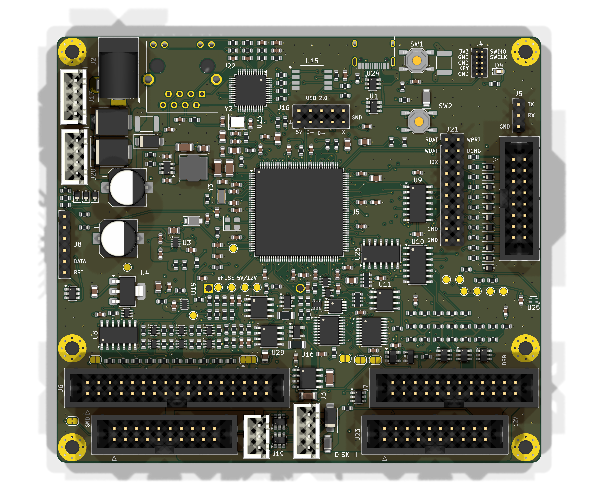
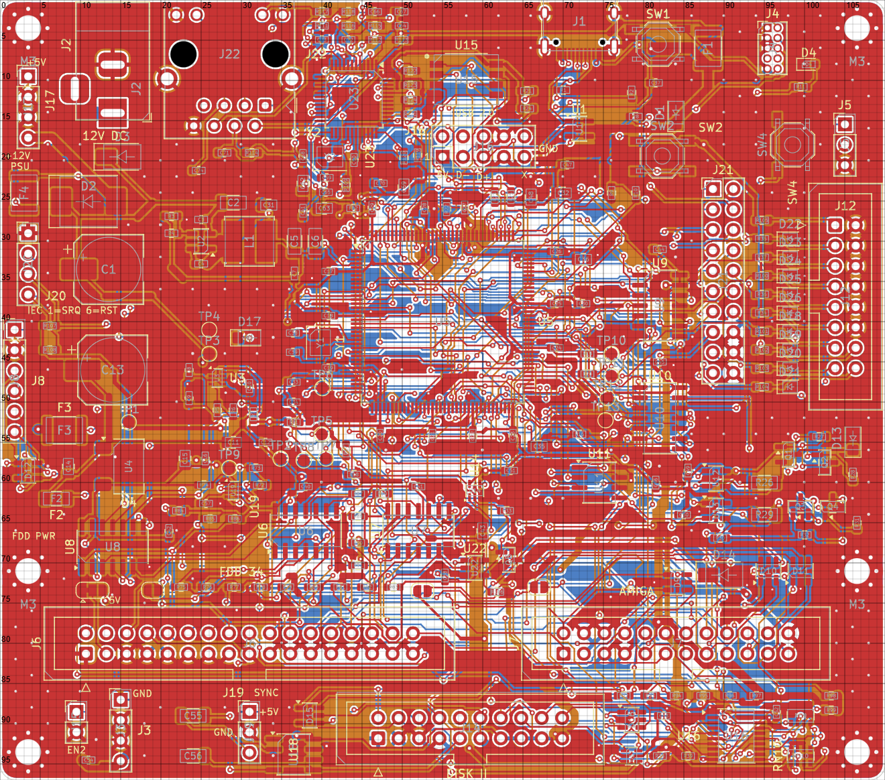
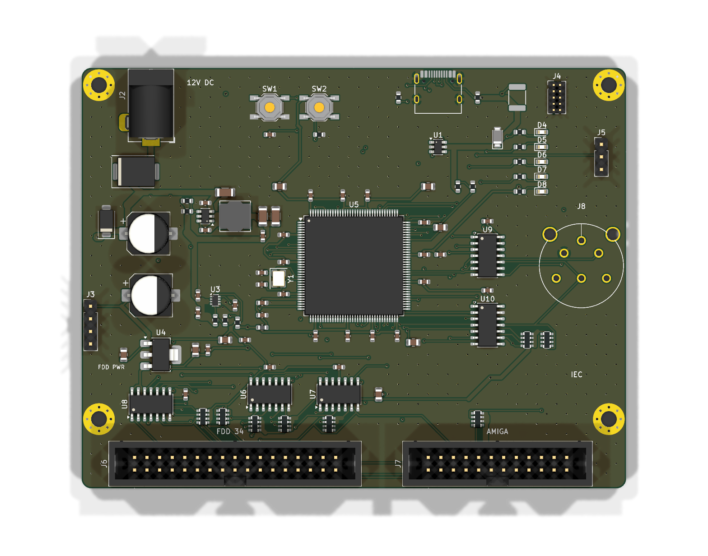

# UFI Headless – STM32H723 Flux Engine (ohne CM5)

Status: **Schaltplan + Layout v1.0 (Stufe B2)** – ERC 0 Verstöße, alle Netze per Netlist-Export geprüft; PCB-DRC 0 Fehler, 0 Warnungen, 0 unverbunden, Schaltplan-Parität ok (Details unten). Offen: Lastpfad-Breiten nach Skill `pcb-routing` (Stufe B3 in `PLAN.md`), Fertigungsfreigabe (Stufe C).

| Sheet | Inhalt | Status |
|---|---|---|
| Power | USB-C (5V + Daten), 12V-Hohlstecker, TPS54202 Buck 12→5V, TPS2116 Power-Mux, AP7361C 3V3-LDO, FDD-Power-Ausgang über Polyfuses F2 (+5V, 1,1 A) / F3 (+12V, 1,1 A), Messpunkte TP1–TP4 (3V3, 5V, 12V, GND) | ✅ |
| MCU_Core | STM32H723ZGT6 (LQFP144), Entkopplung, VCAP, VDDA-Filter, HSE 25 MHz, Reset/Boot, SWD, Debug-UART, LEDs, **8 MB QSPI-PSRAM** APS6404L (U11) an OCTOSPI1 | ✅ |
| Flux_Interface | 2× SN74LS07 Open-Collector (40 mA) für 10 Ausgänge, 74LVC14A Schmitt-Inverter für 6 Eingänge, 1k Pull-ups auf 5V, Messpunkte TP5 (RDATA) / TP6 (INDEX) | ✅ |
| FDD_Connectors | 34-pol IBM-PC/Shugart, Amiga 2×12-Header (Pin n = DB23 Pin n), ESD-Arrays D9–D11 (ESDA6V1-5SC6) auf 15 Busleitungen | ✅ |
| IEC_Bus | SN74LS07 + 74LVC14A, 1k Pull-ups, 1×6-Stiftleiste J8 (Pin n = DIN-6 Pin n: 1 SRQ, 2 GND, 3 ATN, 4 CLK, 5 DATA, 6 RESET), DIN-6-Buchse extern per Kabel, ESD-Array D12 | ✅ |

v0.2 (gegenüber v0.1): PSRAM, ESD-Schutz an den externen Ports, Polyfuses in der Laufwerksversorgung, Messpunkte. Neue Teile haben feste Referenzen oberhalb der v0.1-Maxima (U11, C46, R16, F2/F3, D9–D12, TP1–TP6), alle bestehenden Referenzen sind unverändert.

v0.4: J6 Pin 6 = DRATE über den freien LS07-Kanal U7.11→U7.10 (PF11, Pull-up RN3.3) und Lötbrücke **JP1** (offen ab Werk), J6 Pin 3 über 3-fach-Lötbrücke **JP2** (ab Werk 1-2 = GND). JP1/JP2 sind Kupfer-Jumper, keine Bestückung; Funktion steht im Bestückungsdruck auf der Rückseite, vorne markiert „5V“ die +5V-Seite von JP2 (`scripts/add_silk_label.py`).

v0.5 (neue Teile mit festen Referenzen ab Q1, U12, R17, C47, D13, J9, SW3, TP7):

| Funktion | Teile | Bedienung / Firmware |
|---|---|---|
| Laufwerksversorgung schaltbar | Q1/Q3 AO3401A (High-Side), Q2/Q4 2N7002, 100k-Pull-downs | FDD_5V/FDD_12V aus, solange die MCU im Reset ist; Firmware schaltet 5 V, dann 12 V ein (`BOARD_STATUS` 0x1B) |
| Strommessung | R26/R29 0,1 Ω + U12/U13 INA180A1 (2 V/A) → PC0/PC1 | > 1,5 A für 50 ms → Schiene aus, ERR-LED |
| TVS an den Laufwerksausgängen | D13 SMF5.0CA (FDD_5V), D14 SMAJ15CA (FDD_12V) | – |
| WRITE LOCK | J11 (Jumper), U14 74LVC1G32, R33 | Jumper gesteckt = WGATE in Hardware gesperrt, Firmware meldet „write protected“ |
| Erweiterung | J9 2×5: 3V3, 5V, I²C1 (PB6/PB7, 2,2k), GPIO PE0/PE1, Taster-Leitungen | z. B. OLED-Display + Taster für Betrieb ohne PC; Pin 6 (PE1) ab Firmware 1.13 wahlweise Index-Simulation (Open-Drain, `ufi index-sim 300`/`UFI.CFG index_sim=300`) → Draht an den Indexsensor-Ausgang eines PC-Laufwerks für Flippy-Disketten; dann kein Betriebsart-Schalter an J13 |
| Taster | v0.5–v0.7 SW3/SW4 (PB8/PB9, aktiv low); ab v1.0 nur noch an der Front über J12 Pin 13/14, SW3/SW4 seit A9a gestrichen | frei für Firmware-Funktionen |
| ~~microSD~~ | in v0.6 durch SD-NAND U15 ersetzt (s. u.) | – |
| Board-ID | R17/R18 an PA4 | 10k/10k = 1,65 V = v0.5, 10k/4,7k = 1,06 V = v0.6; steht in `GET_INFO` |
| Messpunkte | TP7 WDATA, TP8 WGATE (MCU-Seite) | – |

v0.6 (Gerät kommt in ein geschlossenes Gehäuse): microSD-Slot J10 entfällt, dafür **SD-NAND U15** fest eingelötet an denselben SDMMC2-Leitungen (Pull-ups R21–R25, C47/C48 bleiben).

| Funktion | Teile | Bedienung / Firmware |
|---|---|---|
| Speicher 4 GB | U15 CSNP32GCR01-AOW (C2841139), LGA-8 8×6,2 mm; derselbe Footprint passt für MKDV8GIL-AST (1 GB, C26159627, günstiger) | FAT32, beim ersten Start formatiert (Volume „UFI“) |
| Dump ohne PC | Taster A ≥ 1 s | ganze Diskette → `DUMPnnnn.SCP` (byte-gleich mit `ufi read-disk`); Taster B kurz = Abbruch |
| Betriebsart-Schalter (optional, extern) | Kippschalter EIN-AUS-EIN an **J13** (1×3, Belegung wie der Schalter): Pin 1 → EXP_IO1/PE0, Pin 2 = 3V3 (Mittelkontakt), Pin 3 → EXP_IO2/PE1 (parallel zu J9 Pin 5/6, die dann nicht anders belegt werden dürfen) | Mitte = Flux (Host-Tool), Pin 1 = **USB-Floppy** (Diskette in Laufwerk A als USB-Laufwerk, PC-Formate 360K/720K/1.2M/1.44M, PID 0x4F56), Pin 3 = SD-Laufwerk. Nach jedem Wechsel blinkt ACT 1×/2×/3× = Flux/Floppy/SD |
| USB-Laufwerk | Taster B ≥ 2 s (nur Schalter in Mitte; oder `USB_MSC` 0x53) | Gerät meldet sich als Massenspeicher „UFI Flux Storage“ (PID 0x4F55), USB-LED an; Taster B ≥ 2 s zurück |
| Board-ID | R18 4,7k | 1,06 V = v0.6 |
| Einstellungen ohne PC | Datei `UFI.CFG` auf dem SD-NAND (wird beim ersten Start angelegt, im SD-Laufwerk-Modus am PC bearbeiten) | `drive=a\|b\|amiga\|amiga2\|ds0…ds3` (Laufwerk für Dump und USB-Floppy), `tracks=80`, `sides=2`, `revs=3`, `button_a=dump\|copy`, `copy_from=`/`copy_to=` (Laufwerksnamen wie bei `drive`), `protocol=ufi\|gw`; Schlüssel klein schreiben |
| Greaseweazle-Modus | Firmware 1.10, `UFI.CFG` `protocol=gw`, Schalter in Mitte (ACT blinkt 4×) | Gerät meldet sich als „UFI Flux Engine (gw-compat)“ (eigene PID 0x4F57); die Greaseweazle-Werkzeuge finden es ohne `--device`: `gw info`, `gw read --drive A disk.scp`, `gw write`, `gw erase`, `gw seek`, `gw delays`. Bus IBM PC (Laufwerk A/B) und Shugart (0–3); Abtastrate 68,75 MHz. Nicht möglich: Amiga-Port J7, IEC, Firmware-Update per `gw update`, `gw bandwidth`, Flippy-Laufwerke, hartsektorierte Disketten. Das UFI-Host-Tool `ufi` braucht `protocol=ufi` |
| Qualitätsbericht | Firmware 1.8 | Zu jedem Dump `DUMPnnnn.LOG`: pro Spur gute/erwartete Sektoren, Drehzahl, Leseversuche (schwache Spuren bis zu 3× gelesen), am Ende Anzahl schlechter Spuren. Format wird auf Spur 0.0 erkannt (PC, DMF, ED, Atari, 1581, Amiga); sonst nur Drehzahl |
| Diskette kopieren | Firmware 1.8, `button_a=copy` + Taster A ≥ 1 s (oder `COPY_START` 0x54) | Flux-Kopie Spur für Spur von `copy_from` nach `copy_to` (z. B. A → B oder ds0 → ds1), mit Prüflesen; Fortschritt/Fehler über `DUMP_STATUS` und ERR-Blinkcode (2 Lesen, 3 Schreiben/Schreibschutz). Kopiergeschützte Disketten mit Spurlängen-Tricks werden nicht garantiert kopiert |
| Front-LEDs (Gehäuse) | J12 2×4 + R34–R37 330 Ω (≈ 4 mA), je LED eine Reihe: 1+/2− PWR, 3+/4− ACT, 5+/6− FDD, 7+/8− ERR | parallel zu den Board-LEDs, keine Firmware-Änderung |

v1.0 (in Arbeit auf dem Branch `hw/v0.7-frontpanel`, Schaltplanstufen A1–A4, Vorgaben in
[docs/PCB_Revision_Empfehlungen_2026-10-24.md](../../docs/PCB_Revision_Empfehlungen_2026-10-24.md)):
das Gerät sitzt in einem geschlossenen Gehäuse, von außen bleiben nur USB und LAN erreichbar,
nichts ist nach dem Einbau steckbar; komplette Bestückung.

| Funktion | Teile | Bedienung / Firmware |
|---|---|---|
| 5-V-Quelle automatisch | U19 TPS2116DRL (VIN1 = externe 5 V von J17 mit Vorrang, VIN2 = 12-V-Buck), R72/R73, C57, Status über R74 auf TP9 | J18 entfällt; `PWR_SRC` zeigt weiterhin die Hauptquelle U3 |
| FDD-/IEC-/Amiga-Abschluss | R75–R99, 25 × 1 kΩ 0603 statt RN1–RN8 | – |
| Front-Header | J12 2×8 Wannenstecker FRONT: 1 +3V3 über R105 1 kΩ, 3 ACT, 5 ERR, 7 USB, 9 FDD, 11 PWR (R34–R37, R100 330 Ω), 13 BTN_A, 14 BTN_B, 15 MODE1, 16 MODE2 (R101–R104 470 Ω), Pins 2/4/6/8 GND, seit A9b Pin 10 FRONT_WRLED und Pin 12 WLOCK_HW (Schalter SCHREIBEN); D18–D26, D28, D29 PESD3V3L1BA. Nur vier Massepins: an der Frontplatte eine gemeinsame Masseschiene für alle Kathoden, Taster und den Schalter | LEDs, Taster A/B und der Modusschalter sitzen an der Frontplatte; J9, J13, die Platinen-LEDs D5–D8 und seit A9a auch SW3/SW4 entfallen (Taster A/B nur an der Front, Service-Drahtbrücke J12 Pin 13/14 gegen GND), D4 ACT bleibt |
| I²C-Testpads | TP10 SCL, TP11 SDA, TP12 +3V3, TP13 GND (R19/R20 bestückt) | Reserve für EEPROM/Sensor |
| WRITE LOCK | ~~JP4 Lötbrücke~~ (A4, durch A9b/A11a/A11f ersetzt): Schalter SCHREIBEN an J12 Pin 12 gegen GND, R33 10k Pull-up, WLOCK_FW PE4 (R131 100k), U14 74LVC1G32 bildet LOCK, U31 74LVC1G02 sperrt WGATE, U30 die Apple-Schreibanforderung | Schalter offen oder Frontkabel ab = gesperrt; Schreiben nur bei Schalter zu und Firmware-Freigabe während eines Schreibauftrags (Zeilen A9b, A11a, A11f) |
| Indexsimulation | PE5 = TIM15_CH1 → U7F (freier LS07-Kanal) → INDEX-Bus | `ufi index-sim 300`: Impuls liegt ohne Draht auf INDEX (Selbsttest `index_loop`); 3,3-V-Impuls auch auf J21 Pin 10 |
| Selbsttest-Rückschleife | U22 TS5A3166 (FD_WDATA↔FD_RDATA, 5 V), Q5 2N7002 (FD_TRK0 → GND), R106 100k, C58; U10F (freier HC14-Kanal, IEC-Blatt) liest FD_WGATE zurück | LOOP_EN = PG14 (im Reset offen), WGATE_SENSE = PG15; Firmware-Nutzung folgt |
| Logikanalysator | J21 2×10 LA: 1 RDATA, 3 WDATA, 5 INDEX, 7 WGATE, 9 STEP, 11 DIR, 13 SIDE, 15 DRVSEL_A, 17 MOTOR_A, 19 TRK0, 2 WPROT, 4 DSKCHG, 6 READY, 8 DENSITY, 10 INDEX_SIM, 12 LOOP_EN, 14 WGATE_SENSE, 16/18/20 GND (alles 3,3-V-Seite) | nur bei offenem Deckel |
| C64 PSU Guard | J20 1×4 GUARD: 1 GND, 2 OFF (PG7), 3 ERR5 (PG8), 4 ERR12 (PC9), R107/R108 10k Pull-ups | 1:1-XH-Kabel (XHP-4 beidseitig) auf J3 der Guard-Platine v0.2 (`kicad/C64_PSU_Guard`, dort ebenfalls B4B-XH-A, gleiche Pinfolge); Firmware-Nutzung folgt |
| LAN (Blatt LAN) | U23 W5500 (LQFP-48) an SPI3, J22 HanRun HR911105A (RJ45 mit Übertragern, Bob-Smith-Netz und LEDs intern), Y2 25 MHz + C59/C60 18 pF + R109 1 M, FB2 + C63–C70 Abblockung, R112/R113 49,9 Ω, R114 10 Ω + C71 22 nF (TX-Mittelanzapfung), C72/C73 6,8 nF + R115/R116 82 Ω + C74 10 nF (RX), R111 12,4 k (EXRES1), C61 10 nF (1V2O), C62 4,7 µF (TOCAP), R117/R118 330 Ω (LINK/ACT-LED im Jack), R119–R121 10 k Pull-ups CS/INT/RST, R122–R124 10 k PMODE = Auto-Negotiation | Werte aus der WIZnet-Referenzschaltung; Firmware hält den W5500 bis zum Treiber im Reset (RST low, CS high) |
| Board-ID | R18 22k (R17 10k) | 2,27 V = v1.0; `INFO` meldet `board_rev` 10, Firmware schaltet damit Apple-Port und Amiga2 frei wie bei v0.7 |
| A11f Review-Fixes (25.10.) | F1: U31 74LVC1G02 (C52953351) bildet das Q9-Gate als NOR(WGATE_n, LOCK); PE14 = WGATE_n aktiv low mit R167 10 k Pull-up, U30-Gatter 1 stillgelegt (das ODER aus A11a hätte seit A11b bei gesetzter Sperre WGATE dauerhaft aktiviert); R1: D30 raus, SYNC_5V am 5-V-Kanal IO3 von D31, J19 = JST B3B-XH-A (C144394); R2: J20 = JST B4B-XH-A (C144395) mit D32–D34 PESD3V3L1BA (C51450); R3: R156/R157 2,4 k (C22940, Greaseweazle-V4.1-kompatibel), JP7 Grundzustand GND | Firmware: `bus_out_inverted()` nimmt PE14 aus, Ruhepegel high; Inbetriebnahme: J6 Pin 24 muss bei gesetzter Sperre während eines Lesevorgangs high bleiben (Messpunkt H-Liste), Selbsttest-Posten in A10; Polaritätstabelle in PLAN.md (A8-Abschnitt) |
| A11d-2 Mac-Port K1, −12-V-Jumper, USB-Schirm (25.10.) | K1: J23 2×10 (`IDC-Header_2x10_P2.54mm_Vertical_UFI`, C2977593) in der Apple-internen 20-Pin-Belegung (1/3/5/7 GND, 2/4/6/8 CA0–LSTRB = AP_PH0–3, 10 !WRREQ, 12 SEL, 14 !ENBL = AP_EN2, 16 RD, 18 WR, 11 +5 V, 13/15/17/19 +12 V, 9 −12 V nur über JP6 (offen), 20 PWM nur über JP5 (offen), zugleich !CSTOUT-Eingang) – Kabel zur DB19-Gehäusebuchse des Owners; U27 SN74AHCT244 (FDD_5V) hebt MAC_SEL (PB0) und MAC_PWM (PA8, TIM1_CH1) auf 5 V, R166 10 k Pull-up und D31 ESDA6V1-5SC6 auf SEL/CSTOUT, CSTOUT_5V → U26 Pin 9 → PB1; J15 entfällt (AP_EN2 liegt auf J23 Pin 14); S5: JP8 (gebrückt) zwischen U18 und J14 Pin 9, keine Sicherung (ICL7662 ≈ 20 mA); S7: J1-Schirm über R164 1 MΩ ‖ C85 4,7 nF an GND | Firmware: Pins seit A11d-1 definiert; Mac-Laufwerkstreiber (SEL/PWM/CSTOUT, 800K/FDHD-GCR) folgt als eigene Firmware-Stufe nach A10 |
| A11d-1 SYNC, J6 Pin 2/4/33, Schienenspannung (25.10.) | M5: J19 Pin 3 → eigenes Netz SYNC_5V (R165 10 k auf +3V3, D30 PESD3V3L1BA) → U26 74LVC14AD (dritter Schmitt-Inverter, Apple_Port) → SYNC an PC6 (TIM8_CH1); S1: J6 Pin 2 (DENSITY) zusätzlich über U26 → PD14; S2: J6 Pin 4 als Ausgang Q12 BSS138DW (R158 100 k, Abschluss R159 1 k auf FDD_5V) + Rücklesen über U26 → PD15, Gate PF14; S3: J6 Pin 33 über Lötjumper JP7 (Grundzustand GND) wahlweise an FLIPPY = PB5 über R156 2,2 k mit R157 2,2 k nach GND; S4: R160/R161 10 k/10 k und R162/R163 33 k/10 k (Power) → PC4/PC5 (ADC1 INP4/INP8); U26 Eingänge 9 = CSTOUT_5V (K1, folgt), unbenutzte Eingänge an GND | Firmware: Pins definiert und als Eingänge bzw. losgelassene Ausgänge initialisiert (`board.h` A11d-Block, `ADC_CH_V_FDD5/12`); TIM8-Capture, ADC-Grenzen 4,5/10,8 V und Protokoll-Ops folgen in A10. Offen (A11d-2): K1 Mac-Header J23 mit U27/JP5/JP6, S5 JP8 an J14 Pin 9, S7 USB-Schirm |
| A11b Shugart-/Amiga-Ausgänge (25.10.) | M3: U6/U7 (LS07) → Q6–Q11 Diodes BSS138DW-7-F (C154900, SOT-363, VGS(th) ≤ 1,5 V, RDS(on) ≤ 3,5 Ω) = 12 Open-Drain-Kanäle MOTOR_A/B, DRVSEL_A/B, STEP, DIR, SIDE, WGATE_G, WDATA, DENSITY, DRATE, INDEX_SIM; R144–R155 100 k Gate-Pull-downs (Reset = losgelassen); IEC-Treiber U9 bleibt LS07 (Owner 24.10.) | Firmware: `bus_out()`/`bus_out_state()` invertieren auf v1.0 für alle Nicht-GPIOD-Leitungen (`board_fdd_mosfet` aus `ufi_board_rev()` am Anfang von `board_gpio_init()`), Ruhepegel der zwölf Leitungen low, TIM3_CH1 (WDATA) und TIM15_CH1 (INDEX_SIM) mit Polarität high; v0.x unverändert |
| A11a Schreibsperre, Abschlüsse, JP2 (24.10.) | M1: U14 wird 74LVC1G32 (LOCK = WLOCK_HW ∨ WLOCK_FW, globales Netz LOCK), U30 74LVC2G32 (Nexperia 74LVC2G32DP C548635, TSSOP-8) gatet FDD_WGATE → FDD_WGATE_G **und** APL_WRREQ → APL_WRREQ_G (U16 2A2), C84 100 nF; M4: R75–R91 und R97–R99 (Shugart/Amiga-Abschlüsse 1 k) von +5V auf FDD_5V; M6: JP2 entfällt, J6 Pin 3 fest GND | Schreibanforderung am Apple-Port läuft jetzt ebenfalls über die Sperre; stromlose Laufwerke werden nicht mehr über die Abschlüsse rückgespeist; keine Firmwareänderung |
| A11c Laufwerksversorgung (24.10.) | U28/U29 TPS25921ADR eFuses (C189199) statt F2/F3 und Q1–Q4: R136/R142 150 k → Strombegrenzung 1,43–1,7 A mit Schnellabschaltung und automatischem Neustart, OVP-Teiler R133/R134 33 k/10 k = 6,0 V und R138/R139/R140 100 k/(10 k + 1 k) = 14,0 V (Schwelle 1,39 V), ENUV von FDD5_EN/FDD12_EN über R135/R141 10 k (R28/R31 100 k halten die Schienen im Reset aus), C81 2,2 nF / C83 1 nF ≈ 2,5 ms Anstiegsrampe, C80/C82 100 nF am IN, FLT über R137/R143 10 k auf +3V3; R26/R29 + INA180 bleiben hinter dem eFuse-Ausgang; D3 SMAJ15CA → SMAJ13A (C110519) | Firmware: FLT5 = PF9, FLT12 = PF10 (nur bei eingeschalteter Schiene bewertet, da ENUV low als Unterspannung zählt), `board_status.power` Bit2/3 + Ereignis 0x83; Sanftanlauf A9 Punkt 3 damit erledigt |
| A9c Takt, Uhr, Sensor (24.10.) | X1 TCXO 25 MHz (HCI TC32H4-25.000-33GNDTNL C5119013, HCMOS ±2,5 ppm; Pin 1 E/D über R132 10k an +3V3, C75 100 nF) statt Y1/C38/C39, OSC_OUT (PH1) offen; Y3 32,768 kHz Epson FC-135 (C48615, CL 7 pF) + C76/C77 10 pF C0G an PC14/PC15; VBAT von +3V3 getrennt: BT1 CR2032-Halter MYOUNG BS-07-A1BJ001 (C2979167, THT, Pad 1 = +) + C78 100 nF; U25 SHT40-AD1B (C2909890, I²C 0x44) + C79 an den I²C-Pads TP10–TP13 | Firmware `ufi_clock.c`: HSE-Bypass zuerst, nach 100 ms Timeout Quarzmodus (v0.x); RTC-Start nur bei board_rev 10 (LSE medium-high nach gm_crit 0,76 µA/V), Kalender läuft von der Zelle weiter; Uhr stellen/lesen und SHT40 folgen in A10 |
| A9b Schreibsperre (24.10.) | Grundzustand gesperrt: R33 10k Pull-up auf WLOCK_HW, JP4 entfällt, U14 74LVC1G332 (3-fach-ODER: FDD_WGATE, WLOCK_HW, WLOCK_FW → FDD_WGATE_G), WLOCK_FW = PE4 Ausgang mit R131 100k Pull-up, WLOCK_HW über R130 470 Ω an PE6 (WREN_SENSE); J12 Pin 12 = WLOCK_HW (Frontschalter SCHREIBEN nach GND), Pin 10 = FRONT_WRLED (+3V3 über R128 1k, LED-Kathode an Pin 12), D28/D29 PESD3V3L1BA; FDD_INDEX zusätzlich an PB11 (TIM2_CH4, AF1 gegen die Pin-Datenbank geprüft) | Schreiben nur bei Schalter EIN und Firmware-Freigabe während eines Schreibauftrags; Frontkabel ab = gesperrt |
| A9a Schutz (24.10.) | J17/J3 als JST XH B4B-XH-A (C144395, verpolsicher, Adapterkabel in `docs/Inbetriebnahme.md`); D27 SS54 als Dioden-ODER für J17 Pin 4 (+12V_PSU) neben D2 (J2); U24 USBLC6-2SC6 als ESD auf CC1/CC2; R125–R127 220 Ω in Serie auf dem Guard-Kabel (GUARD_*_J); R26/R29 50 mΩ (RLM12FTCMR050 C912768) statt 0,1 Ω, F2 1812 wie F3 (C20999); SW3/SW4 gestrichen | Firmware `ufi_board.c` skaliert den INA180-Wert nach Platinenrevision (v1.0 1 mV/mA); A9b/A9c (Schreibsperre, INDEX auf TIM2_CH4, Sanftanlauf, RTC) folgen, siehe `PLAN.md` |
| noch offen | Lastpfade 1,0 mm (Stufe B3), Fertigungsfreigabe (Stufe C). J8, J7 und J3 bleiben interne Stiftleisten, DIN-6 und DB23 sind Gehäusebuchsen am Kabel (Owner 24.10.); Gehäuseausschnitte für J1 (USB-C) und J22 (RJ45) an der Eingangskante | |

Projektbibliothek für U15: `lib/UFI_Headless.kicad_sym` und `lib/UFI_Headless.pretty` (in `sym-lib-table`/`fp-lib-table`); `kisch.py` und `add_parts.py` suchen dort zuerst.

A8 (Verpolschutz 12 V) war schon vorhanden: SS54 in Reihe + SMAJ15CA. A10 (50-pol 8"-Anschluss) passt nicht auf 110×85 mm – 8"-Laufwerke über externen Adapter.

Bestellung: [docs/Bestellung_JLC.md](docs/Bestellung_JLC.md) · Inbetriebnahme des Prototyps: [docs/Inbetriebnahme.md](docs/Inbetriebnahme.md).

## Signalpolarität (wichtig für Firmware)

- **Ausgänge** (FDD_*, IEC_*_OUT): MCU **low** = Busleitung aktiv (low). MCU high bzw. Reset/High-Z = losgelassen (TTL-Eingang des LS07 floatet high).
- **Eingänge** (FDD_INDEX/TRK0/WPROT/RDATA/DSKCHG/READY, IEC_*_IN): durch den 74LVC14A **invertiert** – MCU **high** = Busleitung aktiv (low). RDATA/INDEX-Capture daher auf **steigende** Flanke.

## 34-pol Stecker (J6)

Ungerade Pins GND (Pin 3 über JP2). 2 DENSITY · 6 DRATE (nur mit JP1) · 8 INDEX · 10 MOTOR_A · 12 DRVSEL_B · 14 DRVSEL_A · 16 MOTOR_B · 18 DIR · 20 STEP · 22 WDATA · 24 WGATE · 26 TRK0 · 28 WPROT · 30 RDATA · 32 SIDE · 34 DSKCHG/READY · 4 frei.

| Lötbrücke | Ab Werk | Umbau |
|---|---|---|
| JP1 (Pin 6) | offen – Pin 6 unbeschaltet | brücken für 3-Mode-Laufwerke (DRATE, Firmware `SET_LINES` 0x1A) |
| JP2 (Pin 3) | 1-2 gebrückt = GND | Leiterbahn 1-2 auftrennen, 2-3 brücken = +5V (FDD_5V, über F2) – **nur** für PS/2-Laufwerke mit Versorgung an Pin 3; ein normales Laufwerk hat dort GND → Kurzschluss (F2 löst aus) |
**Shugart-Bus** (Firmware 1.5, gerades Kabel, Laufwerke per Jumper DS0–DS3): Pin 10 = DS0, 12 = DS1, 14 = DS2, **6 = DS3 (nur mit JP1)**, Pin 16 = MOTOR ON für alle → bis zu **4 Laufwerke**. Auswahl `ufi select ds0…ds3` bzw. `UFI.CFG` `drive=ds0…ds3`. Alle Motoren laufen gemeinsam (Strom beim Anlauf beachten); JP1 als DS3 schließt DRATE aus; ein Amiga-Laufwerk an J7 belegt DS1 (Pin 12). PC-Belegung (A/B mit Twist) und Shugart-Bus nicht an einem Kabel mischen.
Abweichungen der Shugart-Belegung (abgeglichen mit pinouts.ru „Floppy Diskdrive pinout“): **Pin 34 = READY** statt DSKCHG – die Firmware (ab 1.6) wertet ihn bei DS0–DS3 als READY; **Pin 2 = /DCD, ein Ausgang des Laufwerks** – bei uns der DENSITY-Ausgang, beide Open-Collector, also harmlos, aber nicht lesbar. Folge: am Shugart-Bus gibt es **keine Diskettenwechsel-Erkennung**. Im USB-Floppy-Modus wird der Spurpuffer verworfen, sobald der Motor stoppt (nie Daten einer Diskette auf eine andere schreiben); nach einem Diskettenwechsel den Betriebsart-Schalter kurz auf Flux und zurück, damit der PC die neue Diskette einliest.

## Amiga-Header (J7) – gegen Amiga HRM verifiziert

Belegung nach Amiga Hardware Reference Manual, Header-Pin n = DB23-Pin n:
1 /RDY · 2 /DKRD · 3–7 GND · 8 /MTRXD · 9 /SEL2B · 10 /DRESB · 11 /CHNG · 12 +5V · 13 /SIDEB · 14 /WPRO · 15 /TK0 · 16 /DKWEB · 17 /DKWDB · 18 /STEPB · 19 /DIRB · 20 /SEL3B · 21 /SEL1B · 22 /INDEX · 23 +12V · 24 GND.
SEL1B teilt sich DRVSEL_B, MTRXD teilt sich MOTOR_B mit dem 34-pol Bus → nur ein Laufwerk gleichzeitig betreiben. SEL2B/SEL3B/DRESB per 1k auf +5V inaktiv.

**v0.7: zweites Amiga-Laufwerk (DF2)** über Lötbrücke **JP3** (offen ab Werk): gebrückt treibt DRVSEL_A den Pin 9 /SEL2B (ESD über D11). Zwei externe Amiga-Laufwerke hintereinander (z. B. A1010 mit Durchschleif-Port, Pin 9 → Pin 21 des zweiten); Firmware 1.9 `ufi select amiga2` bzw. `UFI.CFG` `drive=amiga2`, Kopie `copy_from=amiga`/`copy_to=amiga2`. Jedes Amiga-Laufwerk übernimmt /MTRXD bei der fallenden Flanke seines SEL (Flipflop im Laufwerk, primrosebank.net „Floppy Disk Connection“) – die Firmware legt beim Anwählen den gespeicherten Motorzustand an, Umschalten DF1↔DF2 hält die Motoren. Mit JP3 gebrückt kein Laufwerk an J6 Pin 14 (PC-Laufwerk A / DS2) gleichzeitig betreiben.

Belegung bestätigt gegen Amiga Hardware Reference Manual, Appendix E „External Disk Interface Specification“ (alle 23 Pins). `docs/Amiga_DB23_Adapter_Cable.md` wurde entsprechend korrigiert (vorher GND auf DB23 12/15/20/23 und falsches Steckergeschlecht).

## Apple-Disk-II-Port (J14, J15) – ab v0.7

Platine dafür unten um 12 mm verlängert (110 × 97 mm, zusätzliche Befestigungslöcher H5/H6). J14 = 2×10-Wannenstecker mit der Belegung des Laufwerkssteckers der Disk-II-Controllerkarte – ein Disk-II-Laufwerk wird mit seinem Originalkabel direkt angesteckt:

1/3/5/7 GND · 2/4/6/8 PH0–PH3 · 9 −12 V · 10 /WRREQ · 11/12 +5 V · 13/15/17/19 +12 V · 14 /ENABLE · 16 RDDATA · 18 WRDATA · 20 WRPROT

- Ausgänge über SN74AHCT244 (U16) an FDD_5V: TTL-Pegel, ohne Laufwerksversorgung stromlos (keine Rückspeisung). Phasen aktiv high, /ENABLE und /WRREQ aktiv low, WRDATA wechselt je Flusswechsel den Pegel (TIM3_CH2 im Toggle-Modus). 10k auf der MCU-Seite halten beim Reset alles inaktiv (RN9/RN10).
- Eingänge RDDATA/WRPROT: 10k nach FDD_5V, 74LVC2G17 (U17) an 3V3. RDDATA auf TIM2_CH3 – gleicher Zähler wie die 34-pol Flusserfassung. Ohne Laufwerk meldet WRPROT „geschützt“.
- −12 V (Pin 9) aus FDD_12V mit ICL7662 (U18), Innenwiderstand ≈ 100 Ω – nur für die Disk-II-Analogkarte (wenige mA). Das „Apple 5.25 Drive“ (DB19) braucht keine −12 V.
- **J15** (1×2): /ENABLE eines zweiten Laufwerks (U16 Ausgang 2Y1) + GND – für ein Adapterkabel auf einen zweiten Disk-II-Stecker oder DB19 Pin 9 (/DRIVE2, Daisy-Chain wie am Apple-5.25-Controller).
- DB19-Laufwerke (Apple 5.25 Drive, UniDisk 5.25) über Adapterkabel 20-pol → DB19. **Nicht** unterstützt: Apple 3.5 Drive / UniDisk 3.5 (/EN3.5, SmartPort; DB19 Pin 4 bleibt GND), Macintosh-Laufwerke.
- ESD auf allen Signalleitungen am Stecker (D15, D16).
- **J19 Sync-Sensor** (1 +5 V FDD_5V, 2 GND, 3 SYNC; Bestückungsdruck „+5V GND SYNC“ an den Pins): für einen Sync-Sensor nach Applesauce-Art (Magnet an der Spindel, Hall-Sensor A3144, Open-Collector mit 10k Pull-up, aktiv low, ≥ 500 µs je Umdrehung; wiki.applesaucefdc.com „Sync Sensor“). SYNC liegt direkt auf der INDEX-Leitung des 34-pol Busses (Wired-OR, 1k Pull-up, ESD D11, LVC14 → TIM2_CH2) – elektrisch verhält sich der Sensor wie der Index-Ausgang eines Laufwerks. 34-pol Laufwerke treiben INDEX nur, solange sie angewählt sind. Mit `UFI.CFG apple_sync=1` liest die Firmware Apple-Laufwerke indexbasiert (echte Umdrehungen, SCP mit Index-Flag) und schreibt ab dem Sensorimpuls – Spuren bleiben zueinander ausgerichtet (Kopierschutz mit Spur-Synchronisation). Applesauce-Sensoren haben ein 3,5-mm-Klinkenkabel: Adapter auf J19, Belegung der Klinke vor dem Anschluss am Sensor durchmessen.
- **Schreibschutz**: bis v0.7 sperrte der Jumper J11 in Hardware nur WGATE des 34-pol Busses, den Apple-Port prüfte nur die Firmware. Ab v1.0 (A11a) sperrt LOCK auch die Apple-Schreibanforderung in Hardware: U30 gatet APL_WRREQ → APL_WRREQ_G, gesperrt bei Schalter SCHREIBEN offen oder ohne Firmware-Freigabe.
- Firmware 1.11: Laufwerke `apple` (J14) und `apple2` (J15), `ufi select apple`, `UFI.CFG drive=apple` (`tracks=35`, `sides=1`). Kein Indexloch: Umdrehungen = 200-ms-Abschnitte, SCP mit Disk-Typ Apple II ohne Index-Flag. Kopf: 4-Phasen-Schrittmotor, 2 Halbschritte je Spur, Rekalibrieren = 80 Halbschritte gegen den Anschlag (Klackern, wie beim Original). Schreiben startet sofort (kein Index), Löschen = /WRREQ ohne Pegelwechsel. Board-ID 10k/2,2k = 0,6 V → „v0.7“, nur dann sind die Apple-Laufwerke wählbar.

## Stromaufnahme +5V (Abschätzung)

3× LS07 ≈ 0,12 A · Pull-ups worst case ≈ 0,1 A · MCU über LDO ≈ 0,35 A · 3,5"-Laufwerk ≈ 0,5–1 A Spitze → ≈ 1,5 A. TPS2116 (2,5 A) und Buck (2 A) reichen; an USB-only über dem 500-mA-Default.

## Erzeugen / Prüfen

Die Schaltpläne werden per Skript generiert – **nicht** von Hand in Eeschema bearbeiten, solange das Design noch im Fluss ist (Änderungen gehen beim nächsten Lauf verloren).

```bash
PY="C:/Program Files/KiCad/10.0/bin/python.exe"
CLI="C:/Program Files/KiCad/10.0/bin/kicad-cli.exe"
cd kicad/UFI_Headless
"$PY" scripts/build_schematic.py                       # schreibt *.kicad_sch + netlist_summary.txt
"$CLI" sch erc --severity-all -o erc.rpt UFI_Headless.kicad_sch
"$CLI" sch export netlist -o headless.net UFI_Headless.kicad_sch
"$PY" scripts/verify_netlist.py headless.net           # Soll/Ist-Vergleich aller Netze
```

## Layout v1.0 (Stufe B3, 25.10.2026, 6 Lagen)



- **DRC 0 Fehler / 0 Warnungen / 0 unverbunden, Schaltplan-Parität ok** (`kicad-cli pcb drc --severity-all --schematic-parity` auf der Projektdatei, mit den Bibliotheks-Prüfungen), keine Ausnahmen (Exclusions); `check_routing.py` (Skill `pcb-routing`) Exit 0: 32 von 32 Lastpfaden OK, 0 FEHLER. Ohne Pours gemessen (Owner-Regel): 0 unverbunden, 0 Freiraum-Fehler, 12 717 mm Leiterbahn, 1057 Vias, 231 Netze
- **Lagenaufbau JLC06161H-3313, 1,6 mm** (`scripts/eco/make_6layer.py`): F.Cu 35 µm / 3313 0,0994 mm εr 4,1 / In1 / Kern 0,55 mm εr 4,6 / In2 / 2116 0,1088 mm εr 4,16 / In3 / Kern 0,55 mm / In4 / 3313 0,0994 mm / B.Cu
- **Lagennutzung:** F.Cu Signale + GND-Pour · In1 GND massiv · In2 Signale (bevorzugt waagrecht) · In3 Signale (bevorzugt senkrecht) · In4 GND massiv · B.Cu Signale + GND-Pour. **Abweichung von der Vorgabe S/G/S/S/G+P/S:** In4 ist reine GND-Fläche (Owner-Entscheid B, 25.10.); die Versorgungs-Pours (+3V3, +5V, +12V, FDD_5V, FDD_12V …) liegen per `scripts/power_pours.py` auf den übrigen Lagen, `finish_pcb.py` legt auf 6 Lagen nur die F/B-GND-Pours und Stitching-Vias. Damit hat B.Cu eine ungeteilte Bezugsfläche
- **Kritische Netze** (von Hand vor Freerouting, im DSN gesperrt): USB D+/D− F/B mit 0,15 mm / 0,18 mm Abstand (D+ 3 Vias, D− 5 Vias); Ethernet TX±/RX± auf F.Cu, RXP mit 3,7 mm auf In2; HSE_IN und OSC32_IN/OUT nur F.Cu (≤ 8 mm); OCTOSPI (PSRAM_CLK/CS/IO0–3) und SDMMC2 (SD_CLK/CMD/D0–D3) nur F/B; FDD RDATA/WDATA/INDEX nur F/B
- **Impedanz – Schätzwerte (IPC-2141A, nicht gemessen, vor der Bestellung mit dem JLC-Impedanzrechner bestätigen):** Bezug F→In1 bzw. B→In4 über 0,0994 mm 3313 (εr 4,1). USB 0,15 mm / Abstand 0,18 mm ≈ 50 Ω je Leitung, ≈ 91 Ω differenziell (Soll 90 Ω); Ethernet 0,13 mm ≈ 54 Ω je Leitung, gekoppelt bei 0,18 mm ≈ 99 Ω (Soll 100 Ω). Impedanzkontrolle ist nicht bestellt
- **Lastpfade** (Netzklasse `Load` 1,0 mm, Lastnetze gesperrt; gemessen mit `check_routing.py`/`routing_rules.json`, Widerstand bei 35 µm geschätzt):

| Pfad | Netz | Länge | schmalste Stelle | R |
|---|---|---|---|---|
| J1:A4 → F1 | VBUS | 16,0 mm | 0,6 mm | ≈ 8 mΩ |
| F1 → C10 / C10 → U3 | VBUS_F | 93,8 / 3,1 mm | 1,0 / 0,3 mm | ≈ 46 / 5 mΩ |
| J17:1 → F4 | +5V_PSU | 23,6 mm | 1,0 mm | ≈ 12 mΩ |
| F4 → C57 / C57 → U19 | +5V_PSU_F | 44,2 / 2,1 mm | 1,0 / 0,3 mm | ≈ 22 / 3 mΩ |
| J2 → D2 | +12V_IN | 6,0 mm | 1,0 mm | ≈ 3 mΩ |
| J17:4 → D27 | +12V_PSU | 19,2 mm | 1,0 mm | ≈ 9 mΩ |
| D2 → U2 / D27 → U2 / D2 → U29 | +12V | 39,5 / 32,6 / 63,0 mm | 1,0 mm | ≈ 19 / 16 / 31 mΩ |
| U2 → L1 | BUCK_SW | 2,8 mm | 0,6 mm | ≈ 2 mΩ |
| L1 → C6 / C6 → U19 | +5V_DRV | 6,4 / 37,0 mm | 1,0 / 0,3 mm | ≈ 3 / 20 mΩ |
| U19 → U3 / C8 → U3 | +5V_PRI | 16,3 / 2,9 mm | 0,3 mm | ≈ 13 / 5 mΩ |
| U28 → U3 / C11 → U3 / U4 → U3 | +5V | 39,3 / 3,6 / 21,9 mm | 0,3 mm | ≈ 22 / 6 / 20 mΩ |
| U28 → R26 / R26 → U12 | FDD5_F | 2,4 / 2,1 mm | 1,0 / 0,3 mm | ≈ 1 / 3 mΩ |
| R26 → J3 / J7 / J14 / J23 / J19 | FDD_5V | 16,3 / 64,3 / 57,7 / 59,7 / 34,1 mm | 1,0 mm | ≈ 8 / 32 / 28 / 29 / 17 mΩ |
| U29 → R29 / R29 → U13 | FDD12_F | 2,2 / 2,4 mm | 1,0 / 0,3 mm | ≈ 1 / 4 mΩ |
| R29 → J3 / J7 / J14 / J23 | FDD_12V | 32,4 / 94,7 / 67,3 / 70,8 mm | 1,0 mm | ≈ 16 / 47 / 33 / 35 mΩ |

  „schmalste Stelle“ ist das schmalste Segment des kürzesten Pfads: 0,3-mm-Hälse an den SOT-583-Pins von U3/U19 (TPS2116, 0,5 mm Raster) und die Kelvin-Abgriffe der Shunts zu den INA180, so wie `routing_rules.json` sie je Pfad zulässt (Begründung im `_comment` dort); die Hauptstrecken sind 1,0 mm, Pours kommen dazu
- Routing-Weg: Freerouting 2.4.1 auf 6 Lagen (0,5/0,25-Vias, 0,15-mm-Signale, Netzklassen im DSN, Lastnetze und kritische Netze gesperrt), mehrere Läufe mit unterschiedlichen Einstellungen, bester behalten; Rest per `batch_route.py` / `maze_route.py` und Fenster-Neurouten. Die drei letzten offenen U5-Verbindungen löste der Pin-Tausch der Stufe B3a (LED_FDD → PC7, GUARD_ERR12 → PC9, FDD_MOTOR_B → PC13); R138 (+12V) hängt über ein 0,45/0,2-Via an der +12V-Bahn. Kleinere Vias 0,45/0,2 nur an einzelnen Engstellen (Restring 0,125 mm); das +5V-Via bei (28,55; 43,74) hat Bohrung 0,35 mm
- Neue Werkzeuge: `scripts/eco/make_6layer.py`, `plane_fanout.py` (GND/+3V3-Fanout zu den Ebenen), `pair_offset.py` (Differenzpaare), `bt1_keepout.py` (kein Pour unter BT1 auf B.Cu), `silk_b3.py` (Siebdruck-Texte)

### Layout v1.0, Stufe B2 (24.10.2026, 4 Lagen, durch B3 ersetzt)



- 110 × 97 mm, 4 Lagen (F.Cu / In1 GND / In2 +3V3-Pour + Signale / B.Cu), 6× M3; Eingangskante y = 0 mit J17 PSU-IN, J2 12 V, J22 RJ45, J1 USB-C, J16, J4 SWD, J5 UART; Laufwerkskante y = 97 mit J6, J14, J7, J3; J8 IEC links, J12 Front rechts, J20 Guard links, J21 LA rechts oben
- **J1 und J22 zeigen mit der Öffnung über die Kante** (J1 rot 180 bei y 2,66 mm, J22 rot 180 bei y 13,11 mm); bei Rotation 0 liegen die Öffnungen beider Bibliotheks-Footprints nach innen – so stand die USB-C-Buchse seit v0.1 falsch. Das Gehäuse braucht dort Wandausschnitte
- DRC gegen die JLC-Regeln (`UFI_Headless.kicad_dru`): **0 Fehler, 0 Warnungen, 0 unverbundene Elemente, Schaltplan-Parität ok** (`kicad-cli pcb drc --schematic-parity --severity-all`), kein Via-in-Pad, Vias ≥ 0,5/0,25 mm (Restring ≥ 0,125 mm)
- Routing: Freerouting (Pipeline `make_pcb.sh route`) ließ nach dem 1800-s-Timeout 154 Verbindungen offen, Engstellen an den 0,5-mm-QFP-Reihen von U5/U23; Rest per `scripts/eco/`: `relayout_lan.py` (Quarz-Cluster unter U23), `fanout.py` (0,5/0,25-Dogbones), `batch_route.py` (A*-Router mit Segmentprüfung und Glättung), `place_silk.py` (Referenzen/Texte). Reihenfolge in `scripts/eco/README.md`
- Siebdruck: Referenzen nur für ICs, Stecker, Schalter, Quarze, Sicherungen, Spulen und D4 (`hide_small_refs.py`); SW3 (DNP) steht auf B.Cu unter J22, SW4 auf F.Cu
- Pin-Beschriftung (`scripts/eco/pin_labels.py`): jeder Pin von J3, J4, J5, J8, J12, J14, J15, J17, J19, J20, J21 und der beiden Laufwerksstecker J6/J7 trägt ein 0,8-mm-Label. Auf der Oberseite, wo neben dem Stecker Platz ist (J4, J5, J21 links, J3/J15/J19 teilweise); sonst auf der Rückseite gespiegelt direkt neben den Lötpins (J8, J20, J17, J6/J7/J14 komplett, J12 mit Legende für die Massepins). Die Rückseite ist beim Kabelanschluss auf dem Tisch sichtbar; im geschlossenen Gehäuse sind die Kabel ohnehin gesteckt
- **Lastpfade (Skill `pcb-routing`, gemessen mit `check_routing.py` und `routing_rules.json`): nicht erfüllt.** Alle 16 Lastnetze (VBUS, VBUS_F, +5V_PSU, +5V_PSU_F, +12V_IN, +12V, BUCK_SW, +5V_DRV, +5V_PRI, +5V, FDD5_F/S, FDD_5V, FDD12_F/S, FDD_12V) sind 0,2–0,25 mm breit (plus Pours 0,4 mm je Seite, wo Platz ist); Soll nach Strom (F1/F4 1,5 A, F2/F3 1,1 A, Abschaltung > 1,5 A): 1,0 mm. Pfadlängen F2→R26 88 mm, F3→R29 110 mm, Q1→J3 122 mm, VBUS_F F1→U3 95 mm: die Versorgungskette ist über die Platine verteilt. Netzklasse `Load` (1,0 mm, 0,8/0,4-Vias) ist seit B2 in `.kicad_pro` angelegt (`scripts/eco/set_netclasses.py`); die Umplatzierung und das Neurouten der Lastpfade ist Stufe B3

### Layout v0.2–v0.7 (Vorgeschichte, v0.1 automatisch erzeugt + inkrementelle ECO)



- 110 × 85 mm (v0.1–v0.6; ab v0.7 110 × 97 mm, 6× M3), 4 Lagen, 115 Bauteile (inkl. 6 Messpunkt-Pads), 4× M3
- DRC: **0 Fehler, 0 Warnungen, 0 unverbundene Elemente, Schaltplan-Parität ok**, kein Via-in-Pad. IDC-Konturen von J6/J7 ragen absichtlich über den Rand: per Regel `idc_edge_silk` in `UFI_Headless.kicad_dru` ausgenommen (Fertiger clippt), Bibliotheks-Footprints unverändert
- Fertigungsdaten in `fertigung/`: `UFI_Headless_gerber.zip` (Gerber + Excellon), `UFI_Headless-bom.csv`, `UFI_Headless-pos.csv` (KiCad) und `UFI_Headless-cpl-jlc.csv` (JLC-Spaltennamen + Gehäuse-Rotationsoffsets, `scripts/jlc_cpl.py`), `JLC_Rotation_Check.md` (Pin-1-Checkliste für den JLC-Viewer)

### Layout-Review (gemessen mit `scripts/layout_metrics.py`)

| Bereich | Ergebnis |
|---|---|
| Quarz Y1 | HSE_IN/HSE_OUT je 9,0 mm inkl. Lastkondensatoren, **keine Vias**, symmetrisch (vorgeroutet); seit A9c ersetzt der TCXO X1 den Quarz (nur HSE_IN, kurz, C75 am VDD-Pin) und Y3 32,768 kHz kommt an PC14/PC15 (kurz, keine Vias, GND-Schirm) – wird in B3 neu gelegt |
| Buck TPS54202 | Eingangs-C 100 nF 1,8 mm an VIN, SW-Knoten 2,8 mm gerade zu L1 (0,6 mm), FB-Teiler direkt an Pin 4 (vorgeroutet) |
| Versorgung | Supply-Pours entlang der Routen (`power_pours.py`): +5V/+12V/VBUS ~0,85–1,8 mm effektiv, VBUS_F über In2 ~1,5 mm |
| MCU | 100 nF ~2,8 mm vor jedem VDD-Pin, alle VSS-Pins per Stich + Via direkt auf die GND-Lage |
| USB | D+/D− 43/44 mm (USB FS: Länge/Impedanz unkritisch), ESD U1 zwischen Buchse und MCU |

Handkorrekturen nach dem Autorouting (einmalig auf diesem Board, nicht Teil von `make_pcb.sh`): IEC_RESET-Sackgasse an RN8 ersetzt, PWR_SRC auf B.Cu nach y = 48 mm verlegt, GND-Vias an C33 (VDDA) und am Buck-GND (U2.1/C3.2); nach dem Tausch J8 DIN-6 → Stiftleiste (`scripts/swap_footprint.py` + inkrementelles Freerouting) IEC_SRQ U9↔U10 auf In2 bei x = 87,07 mm; CC2 an J1 links am VBUS-Via vorbei; v0.2-ECO: FD_DRVSEL_B unter D11 auf y = 74 mm verlegt (Platz für das GND-Via von D11.2), TP2/TP6 per `scripts/fix_connections.py` auf ihre Netz-Leiterbahnen gesetzt, Referenztexte per `scripts/place_refs.py`; v0.4-ECO: JP1/JP2 mit `ECO_SEARCH=4` in die Lücke U8/J6 gesetzt, die +5V-Verteilung (lief in v0.3 über U7.11) aus v0.3 übernommen bzw. per B.Cu-Brücke C40↔C41 ergänzt, zwei GND-Stitching-Vias für die Diagonale C43→RN6 entfernt, FD_DRATE U7.10→RN3.3 auf In2 von Hand verlegt; v0.5-ECO: Laufwerksversorgung rechts unten (x 85–106), J10 (microSD) mit Kartenöffnung zur Oberkante, R1 unter die USB-C-Buchse, TP8 misst WGATE hinter dem Sperr-Gatter (alte v0.4-WGATE-Kette dafür umgenetzt), +5V zu RN7/RN8 auf B.Cu, I_FDD5/SD_D1/SD_D3/+3V3/GND(J10.6) mit `scripts/eco/` von Hand bzw. per Labyrinth-Router (`maze_route.py`) verlegt, DRU-Regel für J9 Pin 1 (ein Thermal-Steg + Bahn). Ein neuer Pipeline-Lauf routet anders und kann andere Nacharbeit brauchen – **dieses Board ist der geprüfte Stand**.

### Vor einer Bestellung noch offen

Stand v1.0 (Stufe C, 25.10.2026): Prüfpunkte, Risiken und was erst an der Hardware prüfbar ist stehen im
Freigabebericht [docs/Freigabe_v1.0.md](docs/Freigabe_v1.0.md), die Bestelloptionen in
[docs/Bestellung_JLC.md](docs/Bestellung_JLC.md). Beim Bestellen selbst zu tun:

1. **Rotationen im JLC-Bestückungsviewer** gegen `fertigung/JLC_Rotation_Check.md` prüfen (87 Teile; Offsets nach kicad-jlcpcb-tools eingerechnet, SOT-363/SOT-583 ohne Offset)
2. **BT1 auf der Unterseite**: Bestückung beider Seiten wählen oder BT1 abwählen und von Hand löten
3. **Lager U5** (STM32H723ZGT6, 23 Stück am 25.10.) zuerst prüfen
4. **Impedanzen** im JLC-Impedanzrechner gegen die Schätzwerte im Abschnitt Layout B3 prüfen
5. **IEC-Kabel**: J8 (1×6, 2,54 mm) auf DIN-6-Buchse, 1:1 nach Pinnummer (Lötseite der Buchse beachten)

## Layout-Pipeline (`scripts/make_pcb.sh`)

```bash
export TOOLS=<dir mit jdk-25*-jre + freerouting-2.4.1.jar>
bash scripts/make_pcb.sh eco U11:68:54 C46:77.5:57.5 ...   # Änderung am geprüften Board (Normalfall)
bash scripts/make_pcb.sh all                               # Neu-Layout von Null (place | route | all)
```

**Das geprüfte Board ist die Layout-Quelle.** Schaltplanänderungen kommen per `eco` hinein: `add_parts.py` setzt alle Pad-Netze aus der Netzliste neu, platziert neue Referenzen nahe dem angegebenen Punkt (frei von Courtyards, Löchern und gesperrten Leiterbahnen, möglichst wenige Bahnen im Weg), entfernt nur die Bahnen darunter; danach Pours entfernen, inkrementell routen (Schritte 2–6), Pours neu. Handkorrekturen bleiben dabei erhalten. `all` erzeugt ein neues Layout, das ein neues Review braucht. Netzklassen (Power/Supply) stehen in `.kicad_pro` und `build_pcb.py`.

1. `build_pcb.py` – Footprints aus der Schaltplan-Netlist (mit KIID-Pfaden → Schaltplan-Parität), Platzierung, Outline (seit v0.7 110×97 mm), M3-Löcher, In1-GND-Plane, vorgeroutete USB-C-Auffächerung (gesperrt)
2. Freerouting 2.4.1 (Java 25) – F.Cu / In2.Cu / B.Cu als Signallagen, In1.Cu GND-Plane
3. `drop_violations.py` – Freerouting-Leiterbahnen mit DRC-Verstoß löschen und neu routen (bis sauber)
4. `widen_power.py` – Versorgungsnetze auf 0,8 mm (GND/3V3 0,5 mm) verbreitern, wo DRC es erlaubt
5. `finish_pcb.py` – GND-Pours F/B, +3V3-Pour In2, GND-Stitching-Vias, Inseln anbinden, Zonen füllen, Via-Bohrungen auf Restring ≥ 0,125 mm verkleinern
6. `power_pours.py` – Versorgungs-Pours entlang der Routen

Lagenaufbau: F.Cu Signal + GND-Pour · In1.Cu GND-Plane · In2.Cu Signal + 3V3-Pour · B.Cu Signal + GND-Pour.
Hinweis Fertigung: kein Via-in-Pad. VBUS-Vias sitzen neben den A4/A9-Pads, D−-Vias an J1 sind 0,48/0,23 mm. Seit v1.0 ist J1 um 180° gedreht (Öffnung 1 mm über der Kante, Kontaktreihe innen); die Auffächerung erzeugt `scripts/eco/place_v10.py` aus den Padlagen, die NPTH-Stifte und Gehäusebeine liegen jetzt zwischen Kontaktreihe und Kante.

## Stromversorgung

```
v1.0 (A4, A9a, A11c):
USB-C J1 / J16 VBUS ──F1 1.5A──► VBUS_F ───────────────────────────► U3 TPS2116 VIN2 (Ausweichquelle)
J2 Hohlbuchse ──D2 SS54──┐                                                    │
J17 Pin 4 (PSU 12V) ──D27 SS54──┴► +12V ──U2 TPS54202──► +5V_DRV ──► U19 TPS2116 VIN2 ─┐
J17 Pin 1 (PSU 5V) ──F4 1.5A──► +5V_PSU_F ──────────────────────► U19 VIN1 (Vorrang) ─┴► +5V_PRI ──► U3 VIN1 ──► +5V ──► U4 AP7361C ──► +3V3
+12V ──U29 TPS25921A (1,5 A, OVP 14 V, FDD12_EN)──► R29 50 mΩ ──► FDD_12V (J3 Pin 4, J7 Pin 23, J14)
+5V  ──U28 TPS25921A (1,5 A, OVP 6 V, FDD5_EN)───► R26 50 mΩ ──► FDD_5V  (J3 Pin 1, J7 Pin 12, J14, J19)
```
(v0.7 hatte hier die Polyfuses F2/F3 mit den Schaltern Q1–Q4 und den Jumper J18 für die 5-V-Vorrangquelle; beides ist seit A4/A11c weg.)

**v0.7 – Einbau im PC-Gehäuse:**
- **J16** interner USB-2.0-Header (2×5, **Stift 9 nicht bestücken** = Kodierung, Pad 9 bleibt frei), Belegung wie der Mainboard-Header (Port 1): 1 +5 V, 3 D−, 5 D+, 7/8 GND, 2/4/6/10 frei → 1:1-Kabel 9-pol Buchse–Buchse zum Mainboard. **Steckrichtung:** Bestückungsdruck „1“ = Pin 1 (+5 V), darunter „5V D- D+ GND“ an der Stiftreihe 1/3/5/7, „X“ = Kodierstelle Pin 9. Das zugestopfte Loch der Kabelbuchse kommt auf „X“ – genau wie am Mainboard, wo an derselben Stelle der Stift fehlt. Liegt parallel zur USB-C-Buchse: **immer nur einen Host anschließen** (USB-C oder J16).
- **J17** Stromeingang vom PC-Netzteil, Floppy-(Berg-)Stecker: 1 +5 V, 2/3 GND, 4 +12 V. Die 12 V laufen wie die der Hohlbuchse über SS54/TVS: **J2 oder J17, nicht beide**. +5 V über eigene Polyfuse F4 und TVS D17.
- **J18** Jumper für die 5-V-Vorrangquelle des TPS2116: **1-2 = 12-V-Wandler** (ab Werk, Hohlbuchse oder Netzteil-12 V), **2-3 = Netzteil-5 V direkt** (Bestückungsdruck: „BUCK“ / „EXT“). USB bleibt in beiden Stellungen die automatische Ausweichquelle (fehlt die Vorrangquelle, übernimmt USB). Ohne Jumper läuft das Board nur über USB.

Ein Kurzschluss im Laufwerkskabel begrenzt der betroffene eFuse U28/U29 auf ≈ 1,5 A und schaltet bei Übertemperatur ab (automatischer Neustart, FLT an die Firmware); +5V/+3V3 der Logik bleiben stehen. (v0.7: Polyfuses F2/F3.)

- Nur USB: Logik + 3,5"-Laufwerk aus USB-C. Ohne CC-Auswertung ist offiziell nur der USB-Default-Strom (500 mA) zugesichert; 3,5"-Laufwerke laufen damit in der Praxis meist (wie bei Greaseweazle), für Spec-Konformität später CC-Spannung per ADC auswerten.
- 12V gesteckt: Laufwerks-5V aus dem Buck, 12V für 5,25"-Laufwerke.
- `PWR_SRC` (TPS2116 ST, open-drain, Pull-up auf 3V3) → PG4, Firmware kann die aktive Quelle lesen.

## GPIO-Belegung (Referenz für Firmware)

| Signal | Pin | Funktion |
|---|---|---|
| FDD_RDATA | PA5 | TIM2_CH1 (AF1) Input Capture, 32 bit |
| FDD_INDEX | PA1 | TIM2_CH2 (AF1) Input Capture, gleiche Zeitbasis wie RDATA |
| FDD_WDATA | PA6 | TIM3_CH1 (AF2) Output |
| FDD_MOTOR_A / _B | PE7 / PC13 (bis v0.7 PE8) | GPIO out; B3a: MOTOR_B für das Routing auf PC13 (Backup-Domain, 3 mA, langsam - reicht für das Q6-Gate), Firmware wählt per Revision (board_pin()) |
| FDD_DRVSEL_A / _B | PE9 / PE10 | GPIO out |
| FDD_STEP / DIR / SIDE | PE11 / PE12 / PE13 | GPIO out |
| FDD_WGATE / DENSITY | PE14 / PE15 | GPIO out |
| FDD_DRATE | PF11 | GPIO out → U7.11, J6 Pin 6 nur über JP1 (v0.4) |
| APL_PH0 / PH1 / PH2 / PH3 | PF12 / PF13 / PG6 / PF15 | GPIO out → U16 (AHCT244) → J14 Pin 2/4/6/8, high = Phase an (v0.7) |
| APL_EN1 / APL_EN2 | PG5 / PB12 | GPIO out, low = /ENABLE J14 Pin 14 / J15 Pin 1 (v0.7) |
| APL_WRREQ | PB14 | GPIO out, low = /WRREQ J14 Pin 10 (v0.7) |
| APL_WRDATA | PA7 | TIM3_CH2 (AF2) Toggle → J14 Pin 18 (v0.7) |
| APL_RDDATA | PA2 | TIM2_CH3 (AF1) Input Capture ← U17 ← J14 Pin 16 (v0.7) |
| APL_WRPROT | PB15 | GPIO in ← U17 ← J14 Pin 20, high = geschützt (v0.7) |
| FDD5_EN / FDD12_EN | PE2 / PE3 | GPIO out, high = Laufwerksversorgung an (v0.5) |
| I_FDD5 / I_FDD12 | PC0 / PC1 | ADC1 INP10/INP11, INA180A1 2 V/A (v0.5) |
| WLOCK | PE4 | v0.5–v0.7: GPIO in, high = WRITE-LOCK gesetzt (Jumper J11); ab v1.0 ist PE4 der Ausgang WLOCK_FW (siehe unten), JP4 ist seit A9b weg |
| BOARD_ID | PA4 | ADC1 INP18, Teiler = Board-Revision: 1,65 V v0.5, 1,06 V v0.6, 0,60 V v0.7, 2,27 V v1.0 (Fenster ±200 mV) |
| I2C_SCL / I2C_SDA | PB6 / PB7 | I2C1 (AF4) auf J9 (v0.5), ab v1.0 Testpads TP10/TP11 |
| EXP_IO1 / EXP_IO2 | PE0 / PE1 | GPIO auf J9 (v0.5), Modusschalter J13 (v0.6), ab v1.0 MODE1/MODE2 auf J12 Pin 15/16 |
| BTN_A / BTN_B | PB8 / PB9 | GPIO in, Pull-up, low = gedrückt (SW3/SW4, J9; ab v1.0 J12 Pin 13/14) (v0.5) |
| WLOCK_FW | PE4 | v1.0 (A9b): GPIO out, high = Firmware-Schreibsperre (R131 100k Pull-up, Reset = gesperrt), low nur während eines Schreibauftrags; v0.x: Eingang des Jumpers |
| WREN_SENSE | PE6 | v1.0 (A9b): GPIO in, WLOCK_HW über R130 470 Ω, high = Frontschalter offen/Kabel ab = gesperrt |
| FDD_INDEX (2) | PB11 | v1.0 (A9b): TIM2_CH4 AF1, Index zusätzlich zu PA1/CH2 – CH2 kann damit die RDATA-Pulsbreite messen |
| HSE_IN / HSE_OUT | PH0 / PH1 | v1.0 (A9c): PH0 = 25-MHz-TCXO X1 (HSE-Bypass), PH1 offen; v0.x: Quarz Y1 an beiden Pins – `ufi_clock.c` probiert Bypass zuerst |
| OSC32_IN / OSC32_OUT | PC14 / PC15 | v1.0 (A9c): LSE 32,768 kHz Y3 für die RTC (`ufi_clock_rtc_init()`); v0.x: unbeschaltet |
| VBAT | Pin 6 | v1.0 (A9c): CR2032 BT1 + C78 (RTC läuft ohne Versorgung weiter, VBAT-Laden bleibt aus); v0.x: an +3V3 |
| FLT5 / FLT12 | PF9 / PF10 | v1.0 (A11c): GPIO in, Pull-up, FLT der eFuses U28/U29 (low = Unter-/Überspannung/Übertemperatur, auch solange ENUV low ist); v0.x: unbeschaltet |
| SD CK / CMD / D0–D3 | PD6 / PD7 / PG9–PG12 | SDMMC2 (AF11, D2/D3 AF10) (v0.5) |
| GUARD_ERR12 | PC9 | ab v1.0 GPIO in ← J20 Pin 4 (10k Pull-up R108); B3a vom PG13 (v0.5 Card-Detect, v0.6 unbenutzt) auf PC9 verlegt (Routing) |
| INDEX_SIM | PE5 | TIM15_CH1 (AF4) Output → U7F → INDEX-Bus; ruhend high = Bus losgelassen (v1.0) |
| LOOP_EN | PG14 | GPIO out, high = U22 schließt WDATA↔RDATA, Q5 zieht TRK0 (100k Pull-down R106) (v1.0) |
| WGATE_SENSE | PG15 | GPIO in ← U10F ← FD_WGATE, high = WGATE aktiv (v1.0) |
| GUARD_OFF / GUARD_ERR5 | PG7 / PG8 | GPIO out → J20 Pin 2 (high = Guard-Kanäle aus) / GPIO in ← J20 Pin 3 (10k R107) (v1.0) |
| LAN_SCK / LAN_MISO / LAN_MOSI | PC10 / PC11 / PC12 | SPI3 (AF6) → U23 W5500 (v1.0, Blatt LAN) |
| LAN_CS / LAN_INT / LAN_RST | PA15 / PD5 / PD10 | GPIO out (low = selected) / GPIO in (low = Interrupt) / GPIO out (low = Reset), je 10k Pull-up (v1.0) |
| FDD_TRK0 / WPROT / DSKCHG / READY | PF0 / PF1 / PF2 / PF3 | GPIO in |
| IEC_{ATN,CLK,DATA,SRQ,RESET}_OUT | PD0–PD4 | GPIO out → OC-Treiber |
| IEC_{ATN,CLK,DATA,SRQ,RESET}_IN | PF4–PF8 | GPIO in |
| USB D− / D+ | PA11 / PA12 | OTG_HS mit internem FS-PHY |
| VBUS_SENSE | PA9 | Teiler 22k/33k (5V → 3,0V) |
| CC1 / CC2 | PA0 / PA3 | ADC1 INP16/INP15: Spannung an Rd 5,1k → USB-C-Quellenstrom 0,5/1,5/3 A (`ufi usb-power`), v0.3 |
| (Atari SIO, optional) | PD1 / PF6 / PD0 | UART4_TX → DATA OUT (über IEC_CLK_OUT), UART7_RX ← DATA IN (IEC_DATA_IN, RXINV wegen LVC14), COMMAND = IEC_ATN_OUT – nur Firmware + DIN-6→SIO-13-Kabel, keine Platinenänderung |
| SWDIO / SWCLK / SWO | PA13 / PA14 / PB3 | Debug |
| DBG_TX / DBG_RX | PD8 / PD9 | USART3 (AF7) |
| LED_ACT / FDD / USB / ERR | PG0 / PC7 / PG2 / PG3 (bis v0.7 FDD auf PG1) | High = an; B3a: LED_FDD für das Routing auf PC7, Firmware wählt per Revision (board_pin()) |
| PWR_SRC | PG4 | TPS2116 Status |
| HSE | PH0 / PH1 | 25 MHz |

### Firmware (`firmware/`) – an dieses Board angepasst

- Pintabelle + Polarität zentral in `firmware/include/board.h` / `src/board_headless.c`; alle Module nutzen `bus_out()` / `bus_in()` (logisch: true = Busleitung aktiv)
- Flux lesen: RDATA TIM2_CH1 (PA5) + INDEX TIM2_CH2 (PA1), steigende Flanke, gleiche 32-bit-Zeitbasis; DMA (Double-Buffer, 128-KB-Blöcke) schreibt linear in den Flux-Speicher, Umdrehungen sind Ausschnitte (Grenzen exakt per Zeitstempel)
- Flux-Speicher: 8 MB QSPI-PSRAM U11 (`ufi_psram.c`, OCTOSPI1 memory-mapped bei 0x90000000, 68,75 MHz, bis 20 Umdrehungen); antwortet das PSRAM nicht (ID-/Mustertest), Rückfall auf 224 KB AXI-SRAM
- Flux schreiben: WDATA = TIM3_CH1 (PA6), abwärtszählende PWM, ARR per DMA je Flux-Intervall, gleicher 275-MHz-Takt wie beim Lesen, Präkompensation, Schreibschutz-Prüfung
- IEC getrennt OUT (PD0–4) / IN (PF4–8), Protokoll mit Timeouts, EOI und Turnaround nach Butterfield; Amiga J7: Motor per Select-Latch (MTRXD = MOTOR_B, SEL1B = DRV_SEL_B); Apple-Code hinter `BOARD_HAS_APPLE` (hier 0)
- Build: `cmake -S firmware -B firmware/build -G Ninja -DSTM32CUBE_PATH=<STM32Cube_FW_H7_V1.11.0>` + `cmake --build firmware/build` → 0 Fehler, 0 Warnungen (Compiler + Linker, 41 KB Flash). **Auf Hardware ungetestet.**

## Sourcing-Notizen

- LCSC-Nummern: per JLCPCB-API (05.10.2026, Lagerbestand geprüft) zugeordnet, Tabelle `LCSC` in `scripts/build_schematic.py`. Extended-Teile kosten bei JLC je ~3 $ Rüstgebühr; Spule SRN6045TA-150M (C1330797) hatte nur 189 Stück Lager
- Quarz: YXC X322525MOB4SI (C9006, Basic), 25 MHz, CL 12 pF → Lastkondensatoren 2× 18 pF C0G (C1647); gm_crit ≈ 0,97 mA/V < 1,5 mA/V (H723 HSE)
- IEC: Stiftleiste 1×6 (C37208) statt DIN-6 auf der Platine; DIN-6-Buchse sitzt extern (Gehäuse)
